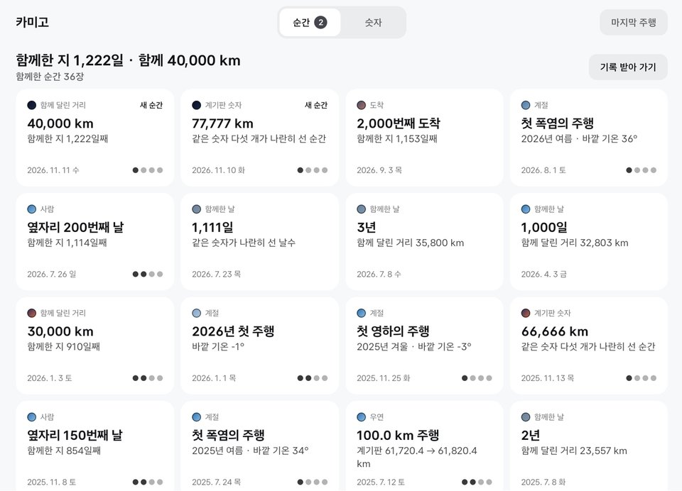
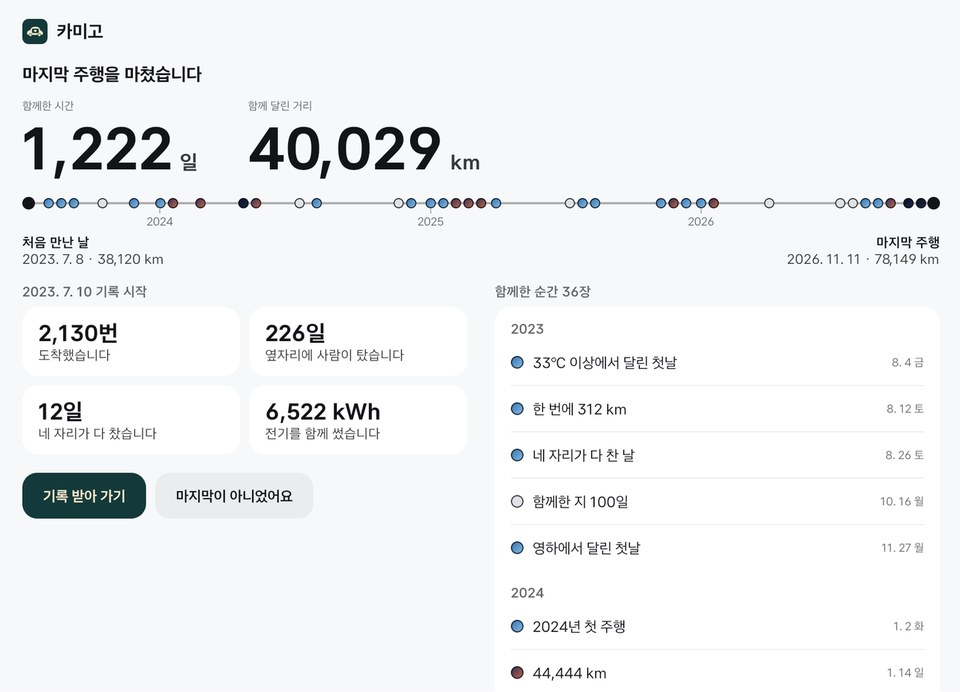
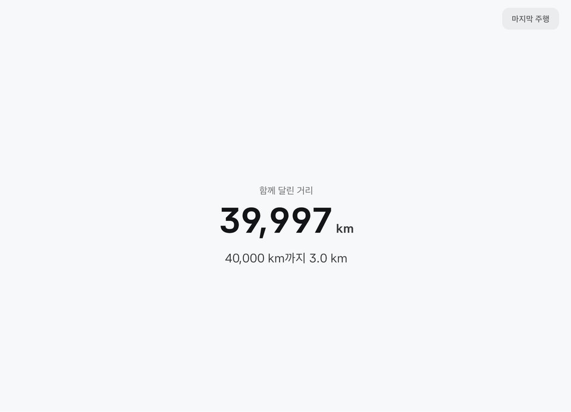
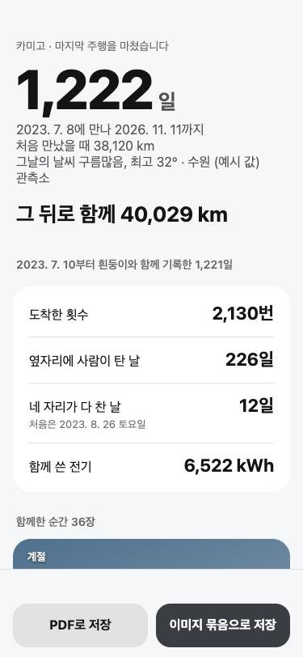
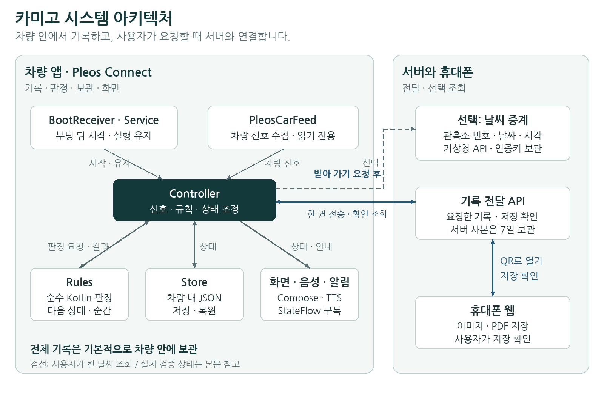

# 카미고

**한 줄 소개:** 차와 함께한 시간과 기념할 순간을 자동으로 기록하고, 그 기록을 휴대폰에 간직하는 차량 앱입니다.

내 차와 내가 처음 만난 날부터 함께한 시간을 남기는 Pleos Connect 차량 앱입니다. 함께 40,000km를 달린 순간, 네 자리가 처음 다 찬 날, 차를 보내기 전 마지막 주행을 기록으로 남깁니다.

| 순간 | 작별 화면 |
|---|---|
|  |  |
| **주행 중** | **휴대폰으로 받은 기록** |
|  |  |

- **주행 하나하나를 적는 운행 기록이 아닙니다.** 받은 날부터 함께 달린 거리(10,000km마다, 지구 한 바퀴)와 특별한 계기판 숫자, 함께한 날수처럼 기념할 순간만 드물게 남깁니다.
- **평소에도 휴대폰으로 받아 보관할 수 있습니다.** 차량 내 백업은 파일 손상에 대비하는 장치이며 앱 삭제·차량 초기화·헤드유닛 교체 뒤의 자동 복구는 제공하지 않습니다.
- **함께하는 동안의 기록이 보내는 날 완성됩니다.** "마지막 주행"을 누르고 도착하면 작별 화면이 열리고, 기록을 휴대폰으로 받아 사용자가 저장을 확인한 뒤에야 카미고의 기록을 지웁니다. 차량의 다른 앱이나 내비게이션 기록은 지우지 않습니다.
- 기록 규칙과 이전 카드의 표시·내보내기 호환성은 **단위 테스트 52개**로 검증합니다.

| 공모전 확인 항목 | 내용 |
|---|---|
| 앱 이름 | 카미고, 패키지 `com.lrlr.carmigo` |
| APK 위치 | [`apk/테오로빈_카미고_release.apk`](apk/) |
| 테스트 환경 | Pleos Connect Emulator 2.1.0 (Android 14). 별도 설정은 필요 없고, 날씨는 숫자 탭에서 켤 때만 씁니다. 실차에서는 확인하지 못했습니다 |
| 에뮬레이터 화면 규격 | 2560×1440 가로 화면에서 확인했고, 세로 화면도 지원합니다 |
| 실행 방법 | 아래 "5분 시연 (시연 모드)"와 "에뮬레이터에서 실행하기" |
| 기획서 | [docs/기획서](docs/기획서/) (본문과 그림, 접수양식 PDF) |

## 5분 시연 (시연 모드)

차를 3년 넘게 탄 기록과 차를 보내는 날을 에뮬레이터 콘솔 조작 없이 볼 수 있도록 앱 안에 시연 모드를 두었습니다. 일반 사용자가 우연히 켜지 않도록 숨겨 두었습니다.

1. `apk/` 폴더의 APK를 설치하고(`adb install -r apk/테오로빈_카미고_release.apk`) 앱 목록에서 카미고를 엽니다.
2. 첫 화면(로고와 "카미고", "시작하기")에서 **로고나 "카미고"를 길게 누릅니다.** 시연 모드 창이 열립니다. ("시작하기"를 누른 뒤의 입력 화면에서는 제목 "이 차와 언제부터 함께하셨나요"를, 첫 입력을 마친 뒤에는 위쪽의 앱 이름 "카미고"를 길게 누릅니다.)
3. **"예시 기록 불러오기"**: 2023년 7월 8일에 계기판 38,120km로 처음 만난 차 "흰둥이"의 3년 4개월 기록(순간 35장, 함께 달린 거리 39,996km)이 열립니다. 날짜는 오늘에 맞춰 옮깁니다. 위쪽에 "시연 모드" 표시가 생기고, 누르면 이 창이 다시 열립니다.
4. 순간 탭과 숫자 탭을 둘러봅니다. 카드를 누르면 그때의 시각, 계기판, 기온, 탄 자리 수가 보입니다.
5. 시연 모드 창에서 **"시연 주행"**: 앱이 기어 D로 출발해 달립니다. 곧 "약 3킬로미터 뒤에 흰둥이와 함께 달린 거리가 40,000킬로미터가 됩니다"라는 음성 안내가 나오고(카미고 화면을 닫아 두면 같은 문장이 화면 위 알림으로도 내려옵니다), 함께 40,000km를 지나 P에 놓으면 "40,000 km" 카드(종류: 함께 달린 거리)가 생깁니다(약 15초). P에서 10초 머물면 도착으로 셉니다.
6. 오른쪽 위 **"마지막 주행"**을 누르고 "마지막 주행으로 남기기"를 고른 뒤, 다시 **"시연 주행"**을 합니다. P에 놓는 순간 작별 화면이 열립니다.
7. **"기록 받아 가기"**: 휴대폰으로 QR을 찍어 기록을 열고 이미지나 PDF로 저장합니다. 휴대폰에서 저장하고 "저장된 것을 확인했어요"를 누르면 차의 화면에 "카미고 기록 지우기"가 열립니다. 지우면 "흰둥이와 함께한 시간을 오래 간직해 주세요."가 남습니다.
8. 시연 모드를 끄려면 창에서 **"시연 모드 끄기"**를 누릅니다. 첫 실행 화면으로 돌아갑니다.

시연 모드에서는 차의 기어, 주행거리, 좌석, 배터리 신호를 쓰지 않고 시연 버튼으로만 움직입니다. 실제 신호로 확인하려면 시연 모드를 끄고 아래 순서를 따릅니다.

## 에뮬레이터에서 실행하기

1. Pleos Connect Emulator를 켭니다.
2. `apk/` 폴더의 APK를 설치합니다: `adb install -r apk/테오로빈_카미고_release.apk`
3. 앱 목록에서 카미고를 엽니다. 처음 화면에서 차를 받은 날과 차를 받았을 때 계기판 거리를 넣습니다(새 차는 "새 차였어요").
4. 에뮬레이터 콘솔에서 기어를 D로 바꾸고 누적 주행거리를 올리면 주행 중 화면이 나옵니다. 기어를 P로 돌리면 주행이 끝납니다.
5. 도착은 P에서 10분을 머물러야 셉니다. 시연 때는 짧게 줄일 수 있습니다:
   `adb shell am start -n com.lrlr.carmigo/.MainActivity --ei demo_arrival_seconds 10`
6. 아무 화면 구석의 "마지막 주행"을 누르고 한 번 달렸다가 P에 놓으면 작별 화면이 열립니다. "기록 받아 가기"를 누른 뒤 휴대폰으로 QR을 찍어 기록을 열고 이미지나 PDF로 저장합니다.

날씨 조회는 기상청 인증키 연결 전입니다. 시연 자료의 날씨는 예시 값이며, 실제 관측 자료 연결과 본 앱의 Pleos 위치 조회는 추가 검증이 필요합니다.

## 무엇을 하는가

| 기능 | 설명 |
|---|---|
| 처음 한 번의 입력 | 차를 받은 날과 차를 받았을 때 계기판 거리만 묻습니다. 함께한 날수와 함께 달린 거리는 넣은 값이 맞는 만큼 첫날부터 정확합니다. 잘못 넣었으면 숫자 탭의 "처음 등록한 정보 수정"에서 고칩니다. 받은 날·계기판 거리를 바꾸면 관련 기념 카드는 삭제하고 새 기준으로 계산하며, 도착·동승 횟수는 유지합니다 |
| 순간 | 드물게만 남깁니다. 이 차와 함께 달린 거리가 10,000km를 넘을 때마다와 지구 한 바퀴마다(두 바퀴, 세 바퀴 …), 달까지의 거리(384,400km), 같은 숫자가 나란히 서거나(44,444, 77,777) 차례로 오르는(12,345, 45,678) 계기판 숫자와 10만 km 단위, 한 번에 처음 300km를 달린 날, 함께한 지 100일·500일·1,000일·2,000일과 같은 숫자 날수(1,111일 등), 해마다 돌아오는 받은 날, 새해 첫 주행, 기록을 시작한 뒤 그해 겨울 영하에서 달린 첫날과 그해 33℃ 이상에서 달린 첫날, 1,000번째 도착마다, 옆자리에 사람이 탄 50번째 날, 네 자리가 처음 다 찬 날, 기록된 거리가 100.0km인 주행. 카드마다 시각, 계기판, 바깥 기온, 탄 자리 수를 함께 적습니다 |
| 숫자 | 도착한 횟수, 옆자리에 사람이 탄 날, 네 자리가 다 찬 날. 앱을 설치한 날부터만 세고, 센 기간을 "2023. 7. 10 기록 시작"처럼 날짜로 밝힙니다 |
| 주행 중 | 함께 달린 거리(정수 km)와 한 줄만 보입니다. 누를 수 있는 것은 없습니다. 다가오는 함께 달린 거리의 이정표(10,000km 단위, 지구 바퀴, 달까지의 거리)와 계기판 숫자는 3km 전에 한 번 음성으로 알리고, 알림을 켰고 카미고 화면이 닫혀 있을 때 같은 문장을 화면 위 알림으로 5초 동안 보여 줍니다(예: 내비게이션 안내 중) |
| 마지막 주행 | 첫 입력을 마친 뒤 순간, 숫자, 주행 중 화면의 한 구석에 늘 보이는 버튼입니다. 차를 보내는 날에 누르면 그 주행이 마지막 기록이 되고, 도착하면 작별 화면이 열립니다. 그 뒤에 다시 달리면 마지막 주행이 이어지는 것으로 봅니다. 다음 주행을 기다리는 동안에는 상태 안내와 "마지막 주행 취소"를 보여 줍니다. 되돌릴 수 있습니다 |
| 기록 받아 가기 | 휴대폰으로 QR을 찍어 기록을 열고 이미지나 PDF로 저장합니다. 휴대폰에서 "저장된 것을 확인했어요"를 누른 것이 서버로 확인되고, 그 뒤로 기록이 달라지지 않았을 때에만 차에 남은 기록을 지울 수 있습니다. 지운 뒤에는 "흰둥이와 함께한 시간을 오래 간직해 주세요."처럼 차 이름과 함께 마지막 안내가 남습니다 |
| 화면 없이 기록 | 최초 등록 후 부팅 시 서비스가 다시 시작되는 것을 에뮬레이터에서 확인했습니다. 실차 전원 주기와 포그라운드 서비스 허용 여부는 확인이 필요합니다 |
| 차 이름 | 처음 입력에서 원하면 차에 이름을 붙입니다(12자까지). 음성 안내와 마지막 인사에 그 이름이 쓰입니다("흰둥이와 함께 달린 거리") |
| 그날의 날씨 | 숫자 탭에서 켜면 순간 카드와 받은 날에 기상청 관측소의 그날 날씨가 붙습니다. 관측소는 이름으로 고르거나 지금 위치에서 가장 가까운 곳으로 고릅니다. 관측 자료가 나온 다음 날부터 채우고, 자료가 없으면 추측하지 않습니다 |
| 알림 | 숫자 탭의 "알림 받기"로 켠 경우에만, 화면이 닫혀 있고 차가 서 있을 때 새 순간(5초 뒤 사라짐)과 휴대폰 저장 확인을 한 줄로 알립니다. 달리는 중에는 다가오는 이정표 안내 한 줄만 5초 동안 보여 줍니다 |

> 향후 계획: 차의 음성 비서(Gleo)에 "함께한 지 얼마나 됐어?"를 등록해 날수와 거리를 답하는 기능을 준비해 두었습니다(`assets/schema.json`, `GleoReceiver`). 공모전 기간에는 앱 기능 등록(App Schema) 승인을 신청할 수 없어 이번 출품에서는 매니페스트에 등록하지 않았습니다.

## 쓰는 차량 신호 (모두 읽기 전용)

| 신호 | 출처 | 쓰임 |
|---|---|---|
| 기어 | Pleos Vehicle SDK `Gear` | P를 벗어나면 주행 시작, P에 놓으면 주행 끝 |
| 누적 주행거리 | `Odometer` | 함께 달린 거리, 계기판 숫자, 100.0km 주행 |
| 좌석별 착석 (4석) | `Seat` | 옆자리에 사람이 탄 날, 네 자리가 다 찬 날, 카드의 탄 자리 수 |
| 배터리 남은 에너지 (Wh) | `EvBattery` | 줄어든 만큼을 더해 "전기 N kWh를 함께 썼습니다" 한 줄 |
| 바깥 기온 | AAOS `ENV_OUTSIDE_TEMPERATURE` | 카드에 적는 그때의 기온. Pleos SDK에서 바깥 기온을 찾지 못해 Pleos Connect가 기반으로 하는 Android Automotive의 공개 Car API로 읽기만 합니다(일반 권한 `CAR_EXTERIOR_ENVIRONMENT`) |
| 주행 중 제한 | AAOS `CarUxRestrictions` | 주행 중 화면을 한 줄로 줄임 |
| 음성 | Pleos TextToSpeech (온디바이스) | 다가오는 함께 달린 거리의 이정표와 계기판 숫자 알림(화면 위 알림과 함께) |
| 대략의 위치 (선택) | Pleos `FusedLocation` (답이 없으면 안드로이드 위치 서비스), `ACCESS_COARSE_LOCATION` | 날씨를 켰을 때 가장 가까운 기상 관측소 고르기. 좌표는 저장하지도 보내지도 않습니다 |

차량 제어는 하지 않습니다. 위치는 날씨를 켠 경우에만 가장 가까운 관측소를 고르는 데 씁니다. 관측소를 처음 고를 때, 그리고 새 순간이 남을 때마다 기기의 마지막 위치로 가장 가까운 관측소를 골라 그 번호만 적습니다. 차 밖으로는 관측소 번호만 나갑니다. 관측소 이름으로 대략의 지역은 알 수 있습니다.

## 차 밖으로 나가는 것

기록은 차량 안의 앱 전용 폴더에 JSON 상태 파일로 보관하며, 직전 세대의 백업을 둡니다. 그날의 날씨를 켠 경우에만 관측소 번호와 날짜, 시각을 서버에 보내 그때의 관측값을 받아 옵니다. 그 밖에는 평소에 아무것도 나가지 않습니다.

운전자가 "기록 받아 가기"를 누를 때에만 그동안의 기록을 서버에 올립니다. 올리는 기록에 들어가는 것은 날짜, 주행거리, 횟수(도착, 옆자리에 사람이 탄 날, 네 자리가 다 찬 날), 함께 쓴 전기, 순간 카드(시각, 계기판, 바깥 기온, 탄 자리 수)입니다. 선택한 날씨와 관측소 이름도 포함됩니다. 좌표, 차대번호, 탑승자의 신원은 내보내지 않습니다. 좌표는 저장하지도 보내지도 않으며, 앱은 탑승자의 신원을 알지 못합니다.

주소는 추측하기 어려운 128비트 난수입니다. QR이나 링크를 아는 사람은 기록을 열 수 있습니다. 올린 기록은 7일 뒤 서버에서 지워집니다. 휴대폰에서 저장을 확인했는지는 받아 가기 화면이 열려 있는 동안과 앱 화면을 다시 열 때 서버에 묻습니다. 주차 중 알림을 켰다면 화면을 닫은 뒤에도 10분 동안 15초마다 묻습니다. 서버는 다른 웹 서버와 마찬가지로 요청한 쪽의 IP 주소를 봅니다.

## 화면 디자인

Pleos Connect UI Design Guide를 따릅니다.

- 색은 가이드의 토큰 값(`background_primary`, `surface`, `text_*`, `button_basic_*`, `button_filled_*`)을 쓰고, 라이트와 다크는 시스템 설정을 따릅니다.
- 글자는 시스템 서체와 가이드의 위계(Headline, Title, Body, Label) 크기를 씁니다.
- 버튼, 탭, 팝업은 가이드의 Basic button, Tabs(Box), System Popup 구조를 따르고, 누르면 95%로 줄어듭니다.
- 앱의 색은 로고의 짙은 청록(#13393B)과 크림(#FDE7CB) 두 가지입니다. 바탕, 글자, 카드는 가이드의 중립색을 그대로 두고, 채운 버튼과 탭의 숫자 표시(라이트: 청록 바탕에 크림 글자, 다크: 크림 바탕에 청록 글자), 새 순간 표시, 앱 아이콘과 시작 화면의 아이콘 판에만 로고 색을 씁니다. 기록 지우기처럼 되돌릴 수 없는 동작의 버튼은 로고 색 대신 OS 기본 중립색으로 두고, 지우기 확인 창의 마지막 "지우기" 단추만 가이드의 negative(빨강) 색을 씁니다. OS 화면 안에서 튀지 않으면서 카미고 화면인 것을 알아볼 수 있게 하려는 선택입니다.
- 가이드 밖의 선택 두 가지: 함께한 날수와 함께 달린 거리는 한눈에 읽히도록 Headline보다 큰 숫자로 적고, 순간 카드에는 그때의 시각을 나타내는 작은 하늘색 점을 둡니다.
- 주행 중에는 움직이는 요소와 누를 것이 없습니다.
- 가로(앱 하나)와 세로(앱 둘로 나눔) 화면을 모두 지원합니다.

## 시스템 아키텍처



- `PleosCarFeed`가 차량 신호를 수집하고, 앱 공용 `Controller`가 순수 Kotlin `Rules`에 입력해 다음 상태와 순간을 계산합니다.
- `Store`는 상태를 차량 내 JSON으로 저장·복원하고, Compose 화면은 `StateFlow`를 구독합니다. 음성·알림은 `Speaker`와 `Notifier`가 맡습니다.
- `BootReceiver`는 부팅·앱 업데이트 뒤 서비스 시작을 시도하고, `RecorderService`는 화면을 닫아도 프로세스 실행을 유지합니다. 실차의 실행 허용 여부는 미확인입니다.
- `Books`와 `BookClient`는 사용자가 받아 가기를 누른 뒤 내보낼 기록을 만들어 HTTPS로 전송합니다. 서버와 휴대폰 웹이 저장 확인을 전달하며, 현재 기록과 확인한 기록이 달라지면 삭제를 허용하지 않습니다.
- 날씨는 선택 조회이며, 차량 안에서 관측소를 고른 뒤 관측소 번호·날짜·시각만 서버로 보냅니다.

주요 변경은 지연 없이 저장 작업을 예약하고, 잦은 주행거리·배터리 갱신은 2초 간격으로 모아 씁니다. 임시 파일 동기화·교체와 직전 백업으로 중단에 대비하되, 저장 전 직전 값까지 무손실로 보장하지는 않습니다. 자세한 SDK 확인 범위와 후속 계획은 [기획서 5번](docs/기획서/README.md#5-개발-계획)에 있습니다.

폴더별 책임은 다음과 같습니다.

```
app/src/main/java/com/lrlr/carmigo/
  core/     기록 규칙(순수 계산, 단위 테스트), 모델, 숫자·날짜 표기
  car/      차량 신호 읽기, 주행 중 제한, 음성
  data/     차 안 저장소, 받아 가는 기록과 서버 통신
  ui/       디자인 토큰, 공통 요소, 화면
  Controller.kt        신호를 규칙에 넣고 결과를 저장
  RecorderService.kt   화면 없이 기록을 이어 가는 서비스
  BootReceiver.kt      부팅·앱 업데이트 뒤 서비스 시작
```

## 빌드

Pleos Connect SDK 저장소(`nexus-playground.pleos.ai`)에 접근할 수 있어야 합니다. JDK 17 이상.

```
./gradlew testDebugUnitTest   # 기록 규칙·표시·내보내기 단위 테스트 52개
./gradlew assembleDebug       # app/build/outputs/apk/debug/app-debug.apk
./gradlew assembleRelease     # signing.properties가 있어야 서명된 APK가 나옵니다
```

Pleos Connect Emulator 2.1.0(Android 14)에서 확인했습니다. 이 에뮬레이터는 좌석 착석 값이 반대로 와서 `INVERT_SEAT_OCCUPANCY`(app/build.gradle.kts)를 기본 방향으로 둡니다. 달리기 시작할 때 운전석이 비어 있다고 읽히면 앱이 방향을 스스로 바로잡습니다.

## 알려진 한계

- 실차 전원 주기에서 프로세스 종료·재시작은 추가 확인이 필요합니다. 앱이 꺼진 사이에 지나간 계기판 숫자는 "그 순간"을 보지 못했으므로 카드로 남기지 않습니다. 앱이 꺼질 때 진행 중이던 주행도 끝을 보지 못했으므로 세지 않습니다.
- 시스템이 앱을 강제로 끝내면 다음 시동이나 앱을 열 때까지 기록이 멈출 수 있습니다.
- 일반 도착은 주행 후 P에 놓고 10분 이상 머문 것을 셉니다. 마지막 주행은 실제 주행 후 P에 놓는 즉시 마칩니다. 어디에 도착했는지는 이 버전에서 다루지 않습니다.
- 전기 사용량은 앱이 켜져 있는 동안 배터리의 남은 에너지가 줄어든 만큼을 더한 값입니다. 회생 제동으로 되찾았다가 다시 쓴 전기도 쓴 것으로 셉니다. 앱이 꺼진 사이에 줄어든 것은 세지 않습니다.
- 휴대폰에 실제로 파일이 저장됐는지는 앱이 알 수 없습니다. 휴대폰에서 직접 확인했다고 누른 것만 압니다.
- 실차에서는 확인하지 못했습니다.

