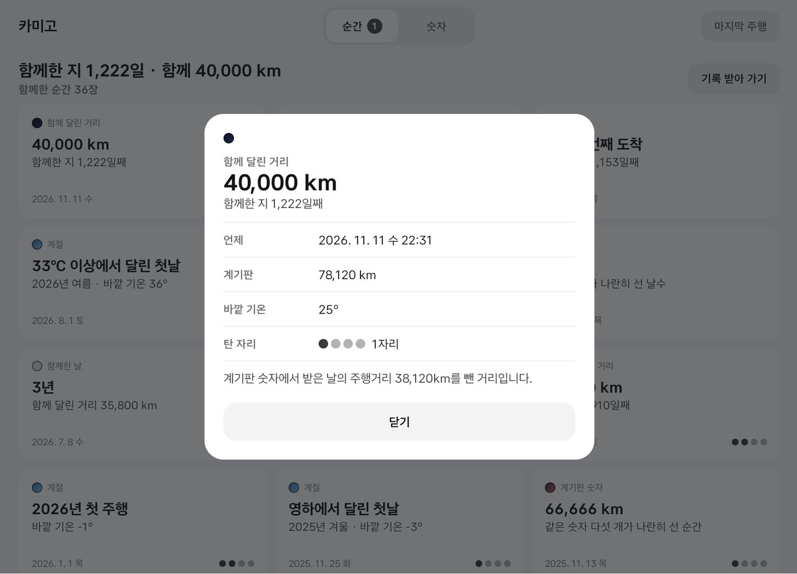
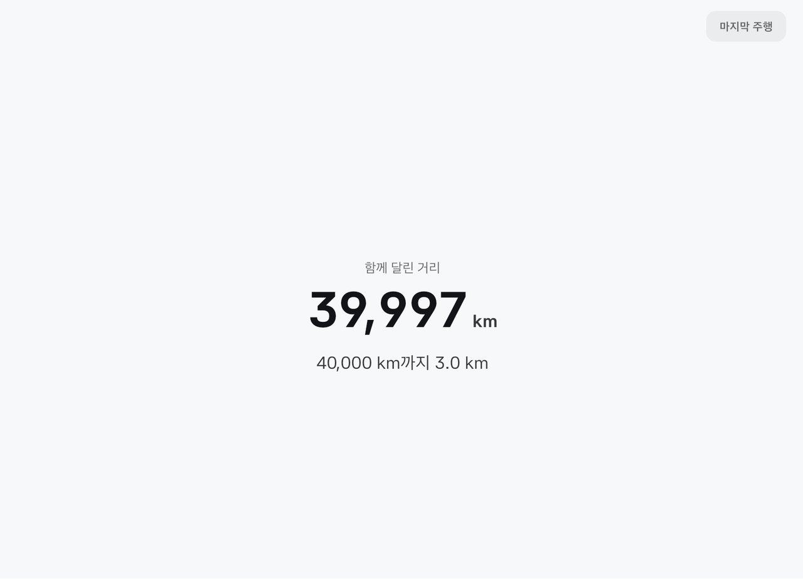
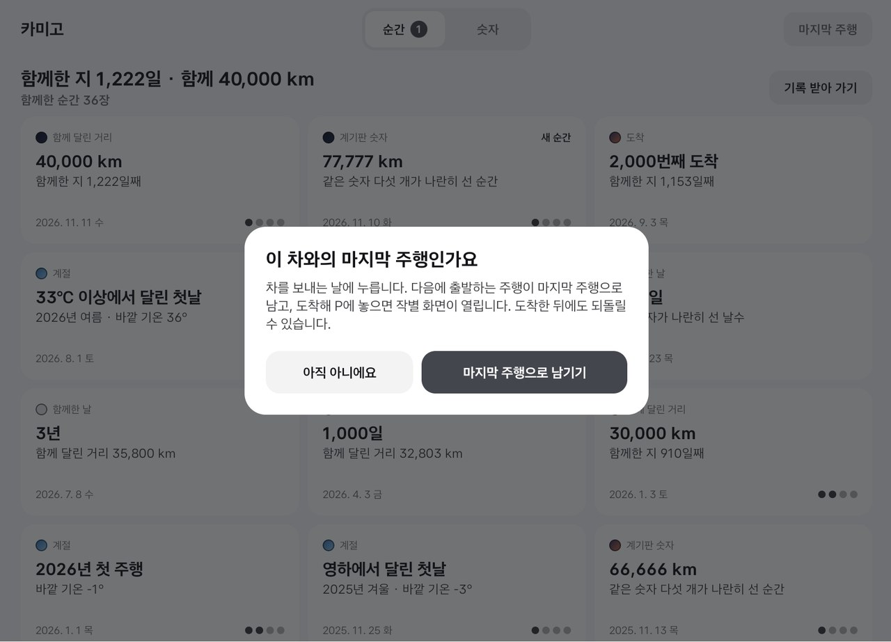
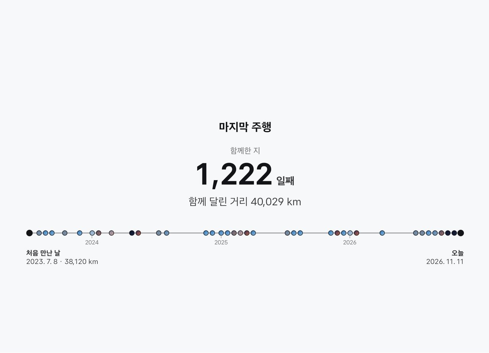
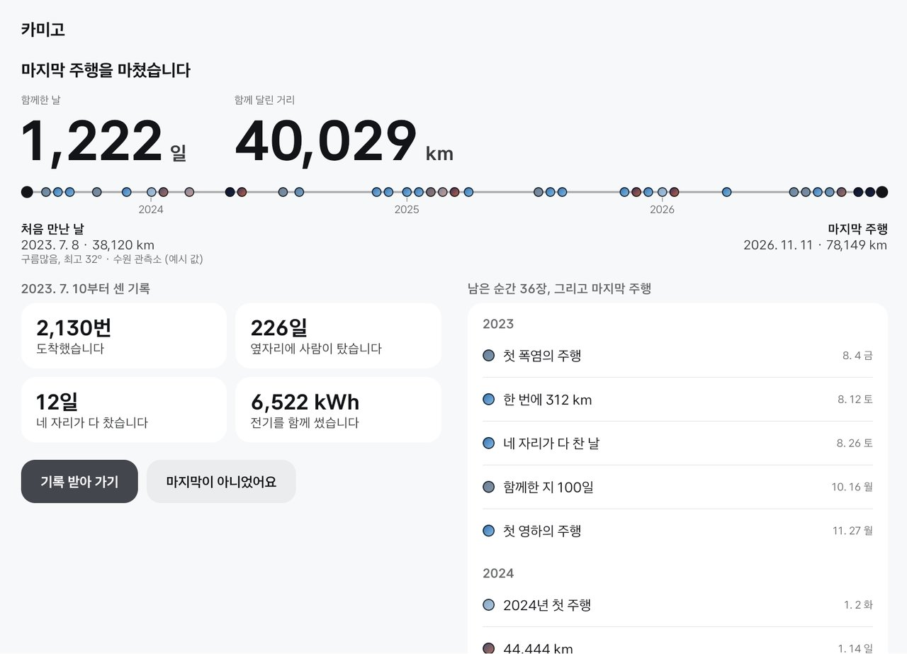
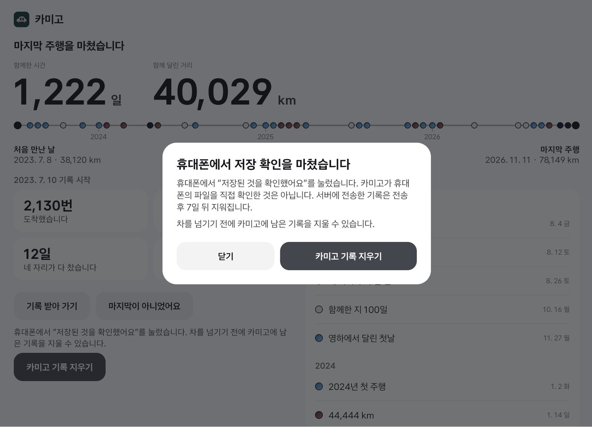
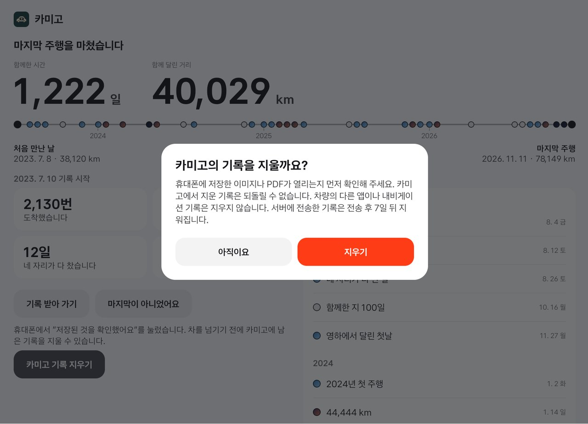
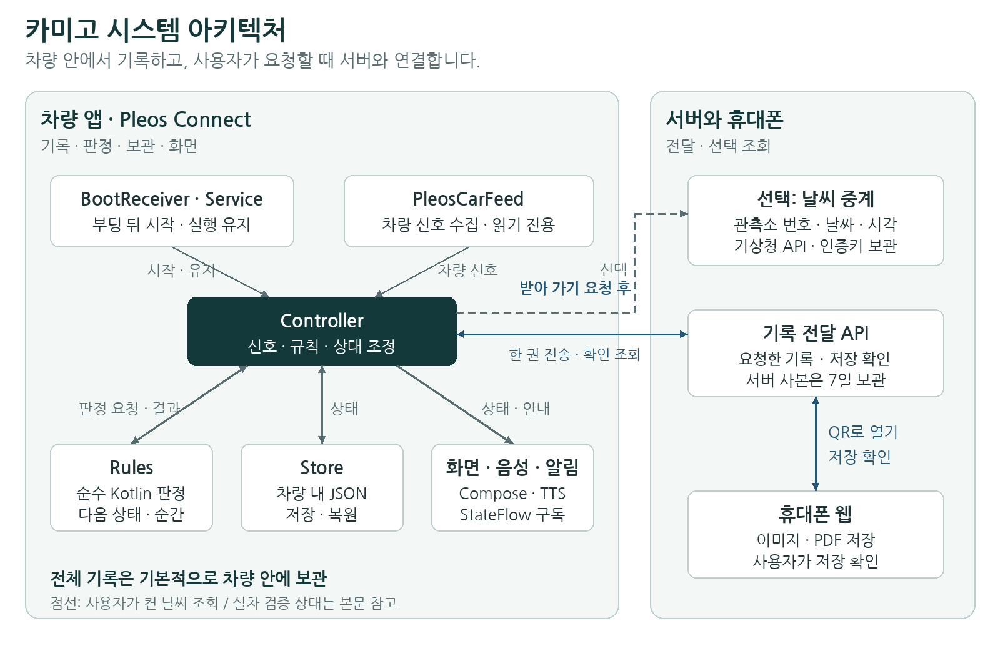

# 카미고 기획서

현대자동차그룹 차량용 앱 개발 공모전 접수양식 "02 앱 프로젝트 소개"의 1~7번 항목에 들어갈 내용입니다. 화면의 날짜와 숫자는 예시 기록의 값입니다. 구현 상태와 검증 범위는 5번 항목에 구분했습니다.

앱명 / 프로젝트명: 카미고

## 1. 앱 한 줄 소개

**차와 함께한 순간을 자동으로 모으고, 차를 보내는 날 기록을 휴대폰에 간직하는 앱입니다.**

함께 40,000km를 달린 순간, 네 자리가 처음 다 찬 날, 차를 보내기 전 마지막 주행을 기록으로 남깁니다.

## 2. 기획 배경

**내 차와 내가 처음 만난 날**

차는 출퇴근을 함께하고, 여행의 동반자가 되고, 때로는 혼자 머무는 작은 공간이 됩니다. 함께한 시간은 쌓이지만, 계기판에는 차가 달려온 전체 거리만 남습니다. 그중 얼마를 나와 함께 달렸는지, 어떤 순간을 함께 지났는지는 따로 기록하지 않으면 알기 어렵습니다.

카미고의 출발점은 내 차와 내가 처음 만난 날입니다. 차를 받은 날과 당시 계기판 거리를 기준으로, 나와 함께한 날수와 거리를 보여줍니다. 처음 만났을 때 계기판이 0km였든 이미 수만 km를 달렸든, 그날부터 시작된 우리만의 시간을 기록합니다.

**지나치는 순간을 기록으로**

함께 40,000km를 달린 순간, 네 자리가 처음 다 찬 날, 겨울의 첫 영하 주행처럼 지나칠 때는 알아채기 어려운 순간이 있습니다. 카미고는 차량 신호로 이런 순간을 발견해 카드로 남깁니다. 운전자가 매번 앱을 열거나 직접 적는 수고를 줄입니다.

앱은 시각과 거리, 기온, 탄 자리 수처럼 관측한 사실만 적습니다. 부모님과 나들이한 날인지, 친구들과 여행을 떠난 날인지는 사람이 기억합니다. 차는 조용한 증인이고, 기록의 의미는 읽는 사람에게 맡깁니다.

**차를 보내는 날, 함께한 기록은 내가 가져갑니다**

정든 차와 이별하는 일은 거래로만 끝나지 않습니다. 헤이딜러의 "나의 운전 졸업식" 캠페인도 운전을 그만두며 마지막 차와 이별하는 사람들의 모습을 사진으로 남겼습니다(7번 항목의 근거 자료). 카미고는 차와 함께한 시간을 간직하고 싶은 마음에 주목했습니다.

평소에 모은 기록은 마지막 주행에서 한 사람과 한 차가 함께한 시간으로 묶입니다. 운전자는 기록을 휴대폰에 저장하고, 차에 남은 카미고 기록을 지운 뒤 차를 보냅니다.

- 처음 만난 날: 함께한 날수와 거리의 기준을 정합니다.
- 함께하는 동안: 차량 신호로 드문 순간을 자동으로 모읍니다.
- 보내는 날: 마지막 주행으로 기록을 끝맺고, 받아 가고, 차에서 지웁니다.

이처럼 함께한 순간을 놓치기 쉽고 마지막 날 기록을 따로 받아 가기 어렵다는 문제의식은 작성자의 관찰입니다. 수요의 크기는 출시 후 사용자 반응으로 검증합니다.

**차량용 앱으로 만드는 이유**

차 안에서 기어, 누적 주행거리, 좌석 착석 신호를 받아 기록합니다. 거리 이정표를 지나기 전에 음성으로 알리고, 차를 세우면 그 순간의 카드를 보여줍니다. 차량 신호를 기록과 화면 전환에 직접 연결할 수 있어 별도 주행 시작 버튼이나 매번의 수동 입력이 필요하지 않습니다.

처음 만난 날부터 마지막 주행까지, 카미고가 남기는 것은 함께 시간을 보냈다는 흔적입니다.

## 3. 앱 주요 기능 및 차량 특화 요소

**처음 만난 날: 두 가지 입력으로 시작합니다**

내 차와 내가 처음 만난 날과 당시 계기판 거리, 두 칸을 입력합니다(그림 1). 지금 계기판은 차에서 읽어 함께한 날수와 거리를 계산합니다. "새 차였어요" 버튼은 당시 거리를 0km로 넣는 편의 기능입니다. 원하면 차에 이름을 붙일 수 있으며(선택, 12자까지), 음성 안내와 마지막 인사에 씁니다. 등록한 정보는 숫자 탭에서 고칠 수 있습니다.

**함께하는 동안: 드문 순간과 함께한 숫자를 모읍니다**

1) 순간 탭. 기념할 만한 순간을 카드로 남기고 주차 후 보여줍니다(그림 2~3). 제목은 "함께 40,000km", "네 자리가 다 찬 날"처럼 사실을 적고, 관측한 시각·계기판 거리·바깥 기온·탄 자리 수를 더합니다. 읽지 못한 값은 적지 않습니다.

| 순간의 종류 | 현재 기록하는 예 |
|---|---|
| 함께한 시간 | 함께한 지 100일·500일·1,000일·2,000일, 1,111일처럼 같은 숫자가 나란히 선 날수, 해마다 돌아오는 처음 만난 날 |
| 함께 달린 거리 | 10,000km마다, 지구 한 바퀴(40,075km)마다, 달까지의 거리(384,400km), 한 번에 처음 300km를 달린 날 |
| 계절 | 새해 첫 주행, 해마다 처음으로 바깥 기온이 영하인 날의 주행, 해마다 처음으로 33°C 이상인 날의 주행 |
| 도착과 동승 | 1,000번째 도착마다, 옆자리에 누군가 탄 50번째 날마다, 관측하는 네 자리가 처음 다 찬 날 |
| 계기판 숫자 | 77,777km처럼 같은 숫자, 45,678km처럼 차례로 오르는 숫자, 10만 km 단위, 기록된 거리가 100.0km인 주행 |

"처음"은 앱이 기록을 시작한 뒤의 관측 범위입니다. 동승 관련 기록은 운전석·조수석·뒷좌석 좌우의 4개 착석 신호를 기준으로 하며, 사람의 신원과 뒷좌석 가운데의 착석 여부는 알지 못합니다. 일반 도착은 주행 후 P에 놓고 10분 이상 머문 경우로 셉니다.

2) 숫자 탭. 함께한 날수와 함께 달린 거리를 가장 크게 보여주고, 현재 계기판 거리를 작은 한 줄로 둡니다(그림 4). 도착한 횟수, 옆자리에 사람이 탄 날, 네 자리가 다 찬 날에는 "2023. 7. 10 기록 시작"처럼 관측 시작일을 함께 적습니다. 처음 만난 날부터 계산한 값과 설치 뒤부터 센 값을 구분합니다.

3) 다가오는 순간 안내. 주행 중 거리 이정표 3km 전에 한 번 음성으로 알립니다. 예: "약 3킬로미터 뒤에 흰둥이와 함께 달린 거리가 40,000킬로미터가 됩니다." 함께 달린 거리의 이정표를 계기판의 특별한 숫자보다 먼저 안내합니다. 알림을 켰고 카미고 화면이 닫혀 있으면 같은 문장을 화면 위 알림으로도 8초 동안 보여줍니다. 카미고 화면을 앞으로 띄우지는 않습니다. 새 순간과 휴대폰 저장 확인 알림은 사용자가 알림을 켠 경우 주차 중에만 보여줍니다.

4) 주행 중 화면. 함께 달린 거리와 다가오는 순간을 알려주는 한 줄만 두고, 입력·카드 열람·설정은 주차 후 이용합니다(그림 5). "마지막 주행" 버튼은 평소 화면 한 구석에 작은 글자로 보이지만 주행 중에는 눌리지 않습니다. 알림이나 음성으로 마지막 주행을 먼저 권하지 않습니다.

5) 선택 기능인 그날의 날씨. 사용자가 켠 경우에만 기상청 관측 자료와 관측소 이름을 카드에 더합니다. 처음 만난 날의 날씨는 사용자가 고른 관측소 기준입니다. 관측소의 날씨와 차량 위치의 실제 날씨가 같다고 단정하지 않습니다. 기본은 꺼짐이며, 현재는 인증키 발급 전이라 예시 값으로 흐름을 확인했습니다. 실제 자료 연결과 위치 검증은 5번 항목에 구분했습니다.

**보내는 날: 마지막 주행, 받아 가기, 차에서 지우기**

6) 마지막 주행. 주차 중 "마지막 주행"을 누르고 확인하면 다음 주행을 마지막으로 기록합니다(그림 6). 달리는 동안 함께한 날수와 거리, 순간이 점으로 놓인 선을 보여줍니다(그림 7). 실제 주행 후 P에 놓으면 기다림 없이 작별 화면을 엽니다(그림 8). 처음 만난 날, 함께한 시간과 거리, 관측 시작일 이후의 숫자, 순간들, 마지막 주행을 하나의 기록으로 묶습니다. "마지막 주행 취소"와 "마지막이 아니었어요"로 되돌릴 수 있습니다.

7) 기록 받아 가기. QR을 휴대폰으로 찍으면 앱 설치 없이 그동안 함께한 기록을 열고, 이미지 묶음이나 PDF로 저장합니다(그림 9~10). 마지막 주행 전에도 기록을 받아 갈 수 있습니다.

8) 차에서 지우기. 마지막 주행을 마친 뒤, 휴대폰에서 사용자가 "저장된 것을 확인했어요"를 눌렀을 때 삭제 버튼이 열립니다(그림 11~12). 이후 기록 내용이 달라지면 다시 받아 가고 저장을 확인해야 합니다. 파일이 실제로 저장됐는지는 앱이 자동 검증하지 않습니다. 사용자가 확인한 뒤 한 번 더 묻고 카미고의 기록만 지웁니다. 휴대폰에 저장한 파일은 남습니다.

마지막으로 "흰둥이와 함께한 시간을 오래 간직해 주세요."라는 안내를 보여주고(그림 13), 닫으면 이전 기록이 없는 첫 실행 화면으로 돌아갑니다. 차량의 다른 앱과 내비게이션 기록은 삭제 대상이 아닙니다.

**경험을 만드는 원칙**

- 의미는 사람이 붙입니다. 차가 1인칭으로 감정을 말하거나 운전을 평가하지 않습니다. 점수·등급·배지는 두지 않습니다.
- 주인공은 함께한 시간입니다. 날수와 함께 달린 거리를 앞세우고, 계기판 전체 거리는 보조로 둡니다.
- 기록은 드물게 남깁니다. 예시 기록은 3년 4개월에 36장이며, 실제 빈도는 주행·동승 패턴에 따라 달라집니다. 매일 접속하거나 알림을 자주 확인하도록 요구하지 않습니다.
- 관측 범위를 밝힙니다. 설치 전의 순간과 횟수는 복원하지 않습니다. 앱이 받지 못한 신호는 추측해 채우지 않습니다.
- 기록의 기본 보관 장소는 차 안입니다. 사용자가 받아 가기를 누를 때 그 기록을 서버로 보냅니다. 날씨를 켠 경우에만 관측소 번호와 날짜·시각을 별도로 조회합니다. 현재 버전에는 가입과 로그인이 없습니다.

차량 특화 요소는 주행거리·기어·좌석 착석으로 기록을 만들고, 바깥 기온으로 순간의 사실을 더하며, 전기차에서는 관측한 배터리 에너지 감소량을 작별 화면의 한 줄로 남기는 것입니다. 차량을 제어하는 API는 쓰지 않습니다. 장소·집 도착·가장 멀리 또는 높이 간 곳·첫 히터는 후속 개발 범위입니다.

**화면**

모두 실제로 실행한 화면입니다. 그림 10은 휴대폰으로 연 웹 페이지이고 나머지는 Pleos Connect 에뮬레이터의 앱 화면입니다. 화면의 기록은 예시입니다. 손으로 적은 값이 아니라, 계기판 38,120km에서 처음 만난 차에 이틀 뒤 앱을 설치해 3년 넘게 탄 경우의 주행을 앱의 판정 규칙에 넣어 만든 기록이며, 4번 항목의 장면도 같은 기록을 따릅니다. 화면 위쪽의 시스템 상태 줄은 잘라냈고, 그림 9의 QR은 실제 주소여서 가렸습니다.

그림 1. 첫 실행. 차를 받은 날과 차를 받았을 때 계기판 거리, 두 칸만 입력합니다. 지금 계기판은 차에서 읽고, 넣는 즉시 함께한 날수와 거리가 나옵니다.

그림 2. 순간 탭. 맨 위에 함께한 날수와 함께 달린 거리, 함께한 순간의 수가 있고, 순간이 최근 것부터 놓입니다. 3년 4개월 동안 남은 36장 가운데 12장이 보입니다. 맨 위는 방금 남은 "40,000 km / 함께한 지 1,222일째"입니다. 오른쪽 위에 "마지막 주행" 버튼이 늘 있습니다.

그림 3. 순간 카드 "40,000 km"(종류: 함께 달린 거리). 이 차와 함께 달린 거리가 40,000km를 넘은 순간의 시각, 계기판, 바깥 기온, 탄 자리가 남습니다. 누가 탔는지는 적지 않습니다. 그날의 날씨와 관측소는 관측 자료가 올라오는 다음 날쯤 이 카드에 한 줄로 더해집니다.

그림 4. 숫자 탭. 함께한 날수와 함께 달린 거리가 가장 크고, 처음 만났을 때와 지금의 계기판은 그 아래 한 줄입니다. 그 아래 "다가오는 순간"에 다음 함께 달린 거리 이정표와 다음 계기판 숫자가 남은 거리와 함께 놓입니다. 오른쪽은 앱을 설치한 날부터 센 숫자입니다.

그림 5. 주행 중 화면. 함께 달린 거리와 한 줄("40,000 km까지 3.0 km")만 보이며 같은 내용의 음성 안내가 한 번 나옵니다. 알림을 켰고 내비게이션 등 다른 화면을 보고 있다면, 같은 안내를 화면 위 알림으로 8초 동안 보여줍니다.

그림 6. 마지막 주행을 누르면 한 번 되묻습니다.

그림 7. 마지막 주행 중 화면. 함께한 날수와 함께 달린 거리, 처음 만난 날부터 오늘까지 순간이 점으로 놓인 선만 보입니다.

그림 8. 작별 화면. 함께한 날수와 함께 달린 거리를 가장 크게 두고, 그 아래 처음 만난 날부터 마지막 주행까지의 선 위에 순간들이 점으로 놓입니다. 왼쪽은 설치한 날부터 센 숫자, 오른쪽은 해마다 함께한 순간들입니다.

그림 9. 기록 받아 가기. QR로 휴대폰에서 엽니다.

그림 10. 휴대폰으로 받은 기록의 첫 화면(실제 서버에서 연 웹 페이지). 처음 만난 날과 그날의 날씨, 함께한 날수와 거리, 함께 기록한 숫자가 먼저 나오고, 아래로 순간들과 마지막 주행이 이어집니다. 아래의 두 버튼으로 PDF나 이미지 묶음으로 저장합니다. 카드 위의 띠는 그 시각의 하늘빛이고, 날씨 줄에는 관측소 이름이 함께 적힙니다.

그림 11. 휴대폰에서 "저장된 것을 확인했어요"를 누르면 차의 화면에 안내가 뜨고, 그때부터 카미고 기록을 지울 수 있습니다.

그림 12. 지우기 전에 한 번 더 묻습니다.

그림 13. 차에 남은 기록을 지운 뒤의 마지막 안내. 차 이름과 함께 "함께한 시간을 오래 간직해 주세요"라는 안내를 남깁니다. 이 화면을 닫으면 첫 실행 화면으로 돌아가고 날짜와 날수도 남지 않습니다.

## 4. 주요 사용 시나리오

**장면 1. 차를 받은 이틀 뒤, 주차 중**

처음 만났을 때 계기판이 38,120km였던 차 "흰둥이"의 예시입니다. 운전자가 처음 만난 날과 당시 거리를 넣자 "함께한 지 2일. 함께 달린 거리 30km."가 나옵니다(그림 1). 처음 만났을 때 계기판이 0km인 경우에도 같은 방식으로 시작합니다. 그 뒤로는 차를 탈 때 기록 서비스가 차량 신호를 받아 순간을 모읍니다.

**장면 2. 한 달 반 뒤, 부모님과 나들이**

부모님을 모시고 넷이 나들이를 갑니다. 도착해 기어를 P에 놓자 "네 자리가 다 찬 날"이라는 카드가 남아 있습니다. 기록을 시작한 뒤 관측하는 네 자리가 모두 찬 첫 주행입니다. 차는 누가 탔는지 모르지만, 운전자는 그날의 나들이를 기억합니다.

**장면 3. 함께한 지 3년 4개월, 주행 중**

함께 달린 거리 40,000km를 3km 앞두고 음성 안내가 한 번 나옵니다. 카미고 화면에는 함께 달린 거리와 한 줄만 있습니다(그림 5). 알림을 켰고 내비게이션을 보고 있다면 같은 안내가 화면 위 알림으로 8초 동안 보였다 사라집니다. 운전자는 휴대폰을 들 필요가 없습니다. 차를 세우면 그때의 시각과 기온이 적힌 카드가 남아 있습니다. 이 예시에서는 3년 4개월 동안 이런 순간이 서른여섯 장 모였습니다(그림 2).

**장면 4. 차를 보내는 날, 처음 만난 지 1,222일**

차를 가지러 오기로 한 날입니다. 운전자는 평소 화면 구석에서 보던 "마지막 주행"을 누르고 확인합니다(그림 6). 마지막으로 동네를 한 바퀴 도는 동안 함께한 날수와 거리, 순간들이 점으로 놓인 선이 보입니다(그림 7).

돌아와 기어를 P에 놓자 작별 화면이 열립니다(그림 8). 함께한 지 1,222일. 처음 만났을 때 38,120km에서 그 뒤로 함께 달린 40,029km, 서른여섯 장의 순간과 마지막 주행이 하나의 기록이 됩니다.

운전자는 QR을 찍어 휴대폰으로 기록을 열고 이미지나 PDF로 저장합니다(그림 9~10). 휴대폰에서 파일을 확인한 뒤 "저장된 것을 확인했어요"를 누릅니다. 차에서 삭제 버튼이 열리면 한 번 더 확인해 카미고의 기록을 지웁니다(그림 11~12). "흰둥이와 함께한 시간을 오래 간직해 주세요."라는 안내가 남습니다(그림 13). 운전자는 운전대를 한 번 쓰다듬고 열쇠를 건넵니다.

차에 정이 들고 함께한 시간을 남기고 싶은 자가 운전자의 흐름입니다. 평소에는 조용히 기록되고, 드문 순간에 한 번씩 돌아보며, 마지막 날에 그동안 함께한 기록을 받아 갑니다.

## 5. 개발 계획

**개발 범위와 현재 상태**

Kotlin과 Jetpack Compose로 차량 앱을 구현했으며, 기록 받아 가기 서버와 휴대폰 웹 페이지를 배포했습니다. 아래의 "확인"은 Pleos Connect Emulator 2.1.0(Android 14, API 34, 전기차 이미지) 기준입니다. 실제 차량에서의 동작과 앱마켓 배포 심사는 아직 확인하지 못했습니다.

| 구분 | 구현·검증 상태 |
|---|---|
| 핵심 흐름 | 첫 입력 → 주행·순간 카드 → 마지막 주행 → QR → 휴대폰 저장 확인 → 차량 내 기록 삭제 → 첫 실행 화면까지 에뮬레이터에서 확인 |
| 자동 기록 | 부팅 후 앱을 열지 않아도 서비스가 다시 시작되는 것을 본 앱에서 확인. 실차 전원 주기와 포그라운드 서비스 허용 여부는 확인 필요 |
| 기록 규칙 | 차량 SDK와 분리한 순수 Kotlin. 판정·표시·내보내기를 다루는 단위 테스트 52개 |
| 날씨·위치 | 날씨 조회 흐름은 예시 값으로 확인. 기상청 인증키 연결과 본 앱의 Pleos 위치 조회 검증은 남아 있음 |
| 후속 기능 | 장소, 집 도착 횟수, 집에서 가장 멀리·높이 간 곳, 하루 최장 거리, 첫 히터는 미구현 범위 |

그림 1~13은 예시 기록을 넣어 실제 앱과 휴대폰 웹 페이지에서 같은 흐름을 실행해 촬영했습니다. 시연용 예시 값과 실제 차량 신호 검증은 구분합니다.

**시스템 아키텍처**

상시 기록과 순간 판정은 차량 앱 안에서 처리합니다. 서버는 사용자가 요청한 기록의 전달과 저장 확인, 선택 기능인 날씨 조회를 맡습니다. 평소 주행 기록을 서버에 계속 보내는 구조가 아닙니다.

구성도 1. 차량 안의 기록 처리와, 사용자가 요청할 때 연결되는 서버·휴대폰의 역할. 점선은 선택 기능인 날씨 조회입니다.

| 구성 요소 | 역할과 연결 |
|---|---|
| 차량 신호 수집 | `PleosCarFeed`가 기어·주행거리·착석·배터리 변경을 구독하고, 바깥 기온을 읽어 Controller에 전달 |
| 실행 유지·조정 | `BootReceiver`가 부팅·앱 업데이트 후 서비스를 시작. `RecorderService`는 포그라운드 실행을 유지하고, 앱 공용 `Controller`가 신호·시각·사용자 동작을 규칙에 전달 |
| 기록 규칙 | `Rules`가 입력 상태와 신호로 다음 상태·순간·음성 안내를 계산. Android와 차량 SDK에 의존하지 않아 독립 테스트 가능 |
| 차량 내 저장 | `Store`가 앱 전용 폴더의 JSON 파일에 상태를 저장·복원. 임시 파일 교체와 이전 세대 백업으로 쓰기 중 중단에 대비 |
| 화면·안내 | Compose 화면은 Controller의 `StateFlow`를 구독. `UxRestrictionWatcher`로 주행 중 제한을 반영하고, `Speaker`와 `Notifier`로 음성·알림을 출력 |
| 기록 전달 | `Books`가 내보낼 기록을 만들고 `BookClient`가 HTTPS로 전송·저장 확인을 조회. 휴대폰 웹에서 열람·이미지·PDF 저장·사용자 확인 |
| 선택 날씨 | 차량 안에서 관측소를 고른 뒤 `WeatherClient`가 관측소 번호·날짜·시각만 서버로 전송. 서버가 인증키를 보관하고 기상청 자료 조회를 중계 |

**기록과 화면이 이어지는 방식**

- 시작과 복원: 최초 등록 뒤 서비스가 차량 신호를 받습니다. 부팅·앱 업데이트 뒤에도 서비스 시작을 시도하고, 저장한 상태를 복원합니다. 설치 뒤 한 번은 앱을 실행해야 합니다. 시스템이 실행을 막거나 프로세스를 강제 종료한 동안은 관측할 수 없습니다.
- 주행과 도착: 유효한 기어 값이 P를 벗어나면 주행을 시작하고, P에 놓이면 주행 종료와 카드 판정을 처리합니다. 거리 증가 등 실제 주행의 근거가 없는 단순 기어 전환은 걸러냅니다. 일반 도착 횟수는 P에서 10분 이상 머문 경우에 더하고, 마지막 주행은 실제 주행 후 P에 놓는 즉시 마칩니다. 주행이 끝나는 시점과 일반 도착 횟수를 늘리는 시점을 구분합니다.
- 저장: 순간 생성·설정 변경·마지막 주행 같은 주요 변경은 지연 없이 저장 작업을 예약합니다. 자주 들어오는 주행거리·배터리 갱신은 2초 간격으로 모아 씁니다. 임시 파일에 쓰고 동기화한 뒤 교체하며, 파일을 읽지 못하면 직전 백업을 시도합니다. 아직 저장되지 않은 직전 값까지 무손실로 보장하지는 않습니다.
- 주행 중 제한: 플랫폼의 주행 중 사용 제한이나 P가 아닌 유효 기어 신호가 있으면 최소 화면으로 전환하고 열린 팝업을 닫습니다. 입력·설정·카드 열람·마지막 주행 선택은 주차 후 이용합니다. 가로·세로와 라이트·다크 화면을 지원하며 Pleos Connect UI 가이드의 색·글자·버튼·탭·팝업 체계를 따릅니다.
- 누락 처리: 앱이 꺼져 있는 동안의 횟수·에너지 감소·지나간 계기판 순간은 추정하지 않습니다. 끝을 관측하지 못한 진행 중 주행도 복원 시 집계에서 제외합니다. 함께한 날수와 총거리는 입력한 기준과 현재 계기판으로 다시 계산할 수 있지만, 자동 기록의 연속성과는 별개의 값입니다.

**서버·휴대폰 전달과 삭제 조건**

사용자가 "기록 받아 가기"를 누르면 기록을 서버에 올리고 QR을 띄웁니다. 열람 주소에는 128비트 난수를 쓰고, 차량 앱의 업로드·상태 조회에는 별도 쓰기 키를 씁니다. QR이나 링크를 아는 사람은 기록을 열 수 있습니다. 서버 보관 기간은 7일로 두며, 차에서 지웠다는 이유로 바로 서버 사본까지 지우지는 않습니다. 휴대폰 저장에 문제가 있으면 보관 기간 안에 다시 받아 갈 수 있습니다.

휴대폰에서 사용자가 "저장된 것을 확인했어요"를 누르면 서버에 확인 시각을 남기고, 차량 앱이 이를 조회합니다. 마지막 주행이 끝났고 현재 기록에 대한 저장 확인이 있을 때만 삭제를 허용합니다. 내보낸 뒤 기록이 바뀌면 이전 확인을 무효로 하고 다시 받아 가도록 합니다. 휴대폰의 실제 파일 저장 성공을 자동 확인하는 방식은 아닙니다.

삭제할 때 차량 내 상태를 비우고 백업·복구용 파일도 지웁니다. 마지막 안내에 쓰는 차 이름 등은 화면을 닫기 전 메모리에만 두고 저장 파일에는 남기지 않습니다. 사용자의 휴대폰 파일과 차량의 다른 앱 데이터는 삭제하지 않습니다.

**SDK/API 사용 계획과 확인 범위**

아래에서 "에뮬레이터 확인"은 신호 확인용 시험 앱 또는 본 앱에서 값을 읽고 변경 반영을 확인한 범위입니다. 위치·기온·TTS처럼 확인 방식이 다른 항목은 따로 적었습니다.

| SDK/API | 사용 목적과 확인·후속 과제 |
|---|---|
| Vehicle SDK `Odometer`, `Gear` | 함께 달린 거리·거리 이정표·주행 구간 판정. 값과 변경 알림은 에뮬레이터 확인. 실차 거리 갱신 단위에 따라 소수 거리 카드 제공 여부 조정 |
| Vehicle SDK `Seat` | 운전석·조수석·뒷좌석 좌우의 4개 신호로 동승 기록. 에뮬레이터의 반전 값을 보정하고 출발 시 운전석으로 방향을 확인. 실차 신호 방향·차종별 지원 여부 검증 필요 |
| Vehicle SDK `EvBattery` | 관측 중 남은 에너지 감소분을 합산. 변경 알림은 에뮬레이터 확인. 총 소비전력의 정밀 계측값이 아니며 회생 후 재사용분도 더함. 내연기관차에서는 해당 한 줄 제외 |
| AAOS 바깥 기온·주행 제한 | `ENV_OUTSIDE_TEMPERATURE`는 읽기 확인, 카드·계절 판정에 사용. `CarUxRestrictions`는 주행 중 화면 제한에 사용. 차종별 제공 값과 제한 전환은 실차 확인 |
| Pleos TTS·Android 알림 | 3km 전 음성 안내. TTS 재생 시작·종료는 에뮬레이터 로그 확인. 앱이 숨겨졌고 알림을 켠 경우 화면 위 알림. 에뮬레이터 기본 내비 화면에서 8초 후 사라짐을 확인. 실제 음량·내비 안내와의 공존은 실차 확인 |
| Pleos `FusedLocation`·Android 위치 | 날씨용 가장 가까운 관측소 선택(처음 고를 때와 새 순간이 남을 때마다 기기의 마지막 위치로). Pleos 위치 값은 시험 앱에서 확인했고 본 앱 검증은 남아 있음. 응답이 없으면 Android 위치로 대체. 좌표는 저장·전송하지 않음 |
| 기상청 지상(종관) 관측 API | 서버 중계로 시간·일 관측 자료 조회. 인증키 연결 전이며 예시 값으로 흐름 확인. 자료가 없거나 통신에 실패하면 날씨 줄을 비움 |
| 후속: 위치·NaviHelper·공조 | 집 좌표 조회와 설정 온도·풍량은 시험 앱에서 확인. 집 도착·고도·현재 위치 주소·공조 전원 알림은 추가 확인 후 2단계에 반영 |

브레이크·방향지시등·창문은 일부 변경 알림이 빠져 실제 조작 횟수로 볼 수 없어 제외했습니다. 충전 횟수·연료 누적도 초기 범위에 넣지 않습니다. 차량 제어 API는 사용하지 않으며 읽기에 필요한 권한과 주행 중 사용 가능 화면을 매니페스트에 선언합니다.

날씨의 관측소 목록은 앱에 포함하며, 가장 가까운 곳을 차 안에서 선택하거나 사용자가 이름으로 고릅니다. 날씨를 켜 두면 새 순간이 남을 때마다 기기의 마지막 위치로 그때 가장 가까운 관측소를 골라 그 번호만 카드에 적습니다. 좌표는 저장하거나 보내지 않습니다. 관측소 이름으로 대략의 지역은 알 수 있어 카드에도 그 이름을 밝힙니다. 받아 가기를 시작한 뒤에는 내보낸 기록의 내용이 뒤늦게 바뀌지 않도록 날씨를 추가로 채우지 않습니다. 실제 관측 자료 연결 전의 값에는 "예시 값"을 표시합니다.

**검증과 남은 개발 순서**

- 1순위: 실차 전원 주기에서 서비스 자동 시작·유지, 앱마켓의 포그라운드 서비스 허용 여부를 확인합니다. 설치 뒤 수동 실행 없이 기록한다는 경험의 전제이므로 가장 먼저 검증합니다.
- 2순위: 착석 값의 방향·결측, 거리 갱신 단위, P 전환과 도착 판정, TTS 음량·시점, 알림 표시를 실차에서 확인합니다. 없는 신호는 관련 칸을 숨기도록 보완합니다. 현재는 카드의 결측 줄과 1kWh 미만 전기 표시를 빼는 데까지 구현했습니다.
- 3순위: 기상청 인증키로 실제 자료 연결과 본 앱의 Pleos 위치 조회를 검증합니다. 실패·자료 없음·네트워크 단절 상황에서도 핵심 기록과 작별 흐름이 이어지는지 확인합니다.
- 4순위: 장소, 집 도착, 집에서 가장 멀리·높이 간 곳, 하루 최장 거리, 첫 히터를 추가합니다. 주소를 기기 안에서 구할 수 없으면 장소를 비우고, 좌표를 서버로 보내 변환하지 않습니다.

**시연과 실제 신호 검증의 구분**

심사용 시연 모드에서는 예시 기록을 오늘 날짜에 맞춰 불러오고, 시연 주행 버튼으로 함께 40,000km의 안내와 카드, 마지막 주행, QR, 휴대폰 저장 확인, 삭제까지 재현합니다. 실제 차량 신호를 구독하는 흐름과 분리되어 있습니다. 실제 신호 확인은 시연 모드를 끈 뒤 에뮬레이터 콘솔에서 기어·거리·착석·배터리 값을 바꿔 수행합니다. 실행 순서는 저장소 README에 있습니다.

## 6. 기대효과 및 발전 가능성

**사용자에게 주는 가치**

계기판만으로는 알 수 없는 "나와 함께 달린 거리"를 알게 되고, 수동으로 적지 않아 놓쳤던 순간을 돌아볼 수 있습니다. 운전의 좋고 나쁨을 평가받지 않고, 차를 보내는 날에는 함께한 시간의 기록을 받아 갑니다. 받아 가기와 차량 내 기록 삭제를 한 흐름으로 연결해 마지막 날 해야 할 일도 분명하게 만듭니다.

**타깃 고객과 사용 계기**

1차 고객은 내 차와 함께한 시간을 남기고 싶은 자가 운전자입니다. 구매 방식이나 차의 연식보다 애착과 기록 욕구를 기준으로 합니다. 처음 만난 날 설치하면 그날부터 순간을 쌓을 수 있고, 오래 함께한 뒤 설치해도 처음 만난 날과 당시 계기판을 입력해 함께한 날수와 거리를 돌아볼 수 있습니다. 과거의 세부 순간과 횟수까지 복원하지는 않습니다.

설치 계기는 차를 받은 날과 차량용 앱마켓 탐색, 다시 여는 계기는 드문 순간 알림과 함께한 숫자 확인, 가장 크게 쓰는 계기는 차를 보내는 날입니다. 제휴는 신차 인도 등 차를 받는 과정에서 기록 시작을 안내하고, 인증중고차·트레이드인 등 차를 보내는 과정에서 이미 쌓은 기록을 받아 가도록 돕는 방향입니다.

**예상 MAU와 Retention Rate**

지원 차량 수·설치율·열람률의 검증된 수치가 없어 아래는 예측 실적이 아닌 가정입니다. MAU는 그 달에 한 번 이상 화면을 연 차량 수로 정의하고, 백그라운드 기록만 이뤄진 차량은 포함하지 않습니다.

| 산정 항목 | 가정과 확인 방법 |
|---|---|
| 계산식 | 지원 차량 수 × 설치율 × 월간 화면 열람률 |
| 보수적 시나리오 | 지원 차량 100만 대당 설치율 3% × 열람률 40% = 월 12,000대 |
| 확대 시나리오 | 지원 차량 100만 대당 설치율 10% × 열람률 60% = 월 60,000대 |
| 유지 지표 | 설치 90일 뒤 유지 비율, 설치 차량의 월간 화면 열람률을 우선 확인. 실측 전이므로 Retention 목표치를 임의로 제시하지 않음 |

매일 여는 앱이 아니므로 일간 접속을 늘리는 방식은 목적과 맞지 않습니다. 오래 쌓인 기록과 마지막 날 받아 갈 기록이 유지 이유가 되는지를 검증합니다. 현재 기록을 상시 수집하는 분석 서버는 없으며, 출시 후 앱마켓이 제공하는 집계 통계로 확인합니다. 제공되지 않는 지표는 측정할 수 있다고 가정하지 않습니다.

**플랫폼 가치와 향후 확대**

차량 신호를 감성적인 기록 경험으로 연결해 내 차에 대한 애착을 만들고자 합니다. 이것이 브랜드 애착과 다음 차량 선택으로 이어지는지는 검증할 가설입니다.

- 다음 차에서 이전 차와의 기록 이어 보기: 현재는 휴대폰에 보관하며, 차량 간 가져오기와 계정은 후속 개발입니다. 같은 플랫폼에서 기록을 이어 볼 이유를 만드는 방향입니다.
- 가족이 함께 타는 차: 운전자별 기록은 별도 식별과 동의 흐름을 검토한 뒤 확대합니다. 현재는 한 차·한 기록입니다.
- Gleo 음성 질의: "흰둥이와 함께한 지 얼마나 됐어?"에 답하는 연동을 준비합니다. 현재 APK에는 등록하지 않았으며 App Schema 승인 절차가 가능할 때 진행합니다.
- 제공·수익 계획: 개인 사용자는 무료를 기본 방향으로 두고, 기록을 책·인화물로 만드는 유료 출력과 차량 인도·인계 파트너 제휴를 검토합니다. 현재 구현된 유료 기능이나 체결된 제휴는 없습니다.

**기존 기록 서비스와의 차이**

차계부의 관리 이력이나 주행 일지의 매번의 운행 대신, 한 사람과 한 차가 함께한 기간과 드문 순간을 중심에 둡니다. 다음 구매자에게 넘길 증빙보다 지금의 차주가 가져갈 개인 기록을 만들고, 마지막 주행 → 휴대폰에 받아 가기 → 차에서 지우기까지 끝맺는 것이 차별점입니다.

자동 기록·카드·QR 자체는 다른 앱에서도 쓸 수 있는 형식입니다. 차별성은 개별 기술의 독점성보다 처음 만난 날부터 마지막 날까지 이어지는 경험에 있습니다. 공개 출품작 소개 일부를 2026년 11월 10일에 살펴본 범위에서는 같은 흐름을 찾지 못했으나, 전체 시장이나 모든 출품작을 비교한 결과는 아닙니다.

## 7. 참고자료

- 화면 자료: 3번 항목의 그림 1~13(실제 차량 앱 화면 12장, 휴대폰 웹 화면 1장). 날짜·숫자는 시연용 예시입니다.
- 구성 자료: 5번 항목의 시스템 아키텍처와 구성 요소별 역할. 차량 앱의 실제 클래스와 데이터 흐름을 기준으로 작성했습니다.
- 기획 참고: 헤이딜러 "나의 운전 졸업식" 캠페인 소개(보그 코리아 광고 콘텐츠, 2025). 정든 차와의 이별을 기록한 사례이며 시장 수요의 정량 근거는 아닙니다. https://www.vogue.co.kr/?p=643012
- 기술 참고: Pleos Playground 개발 문서(Vehicle SDK, TextToSpeech, FusedLocation, NaviHelper)와 Pleos Connect UI Design Guide. 구체적인 사용·확인 범위는 5번 항목에 적었습니다.
- 소스 코드·APK·실행 안내: https://github.com/raphael1063/carmigo (차량 앱 소스와 테스트, APK는 apk/ 폴더, 시연 순서는 README).
