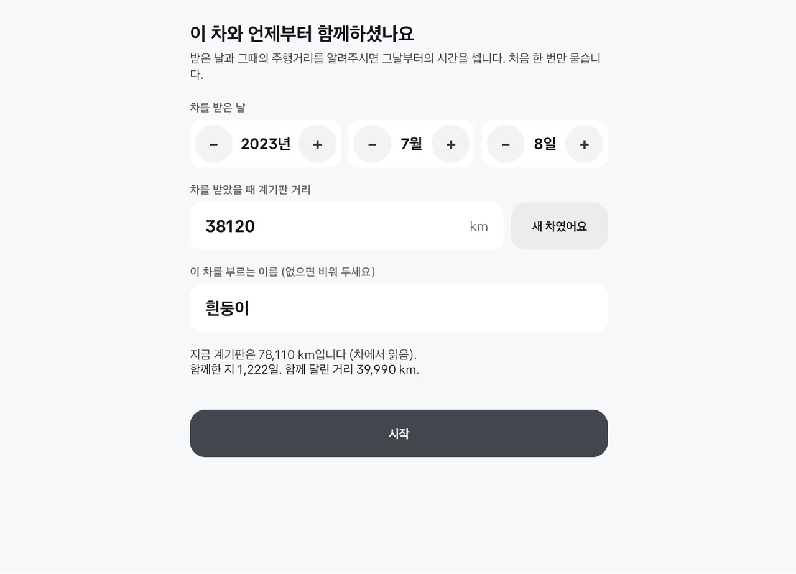
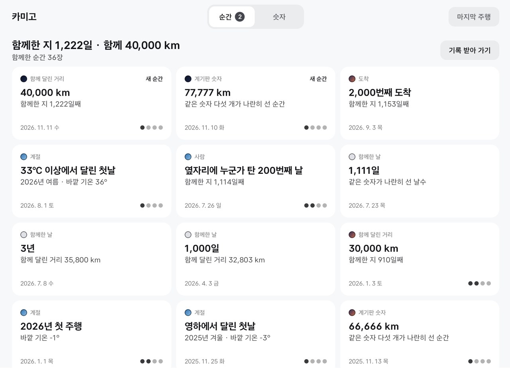
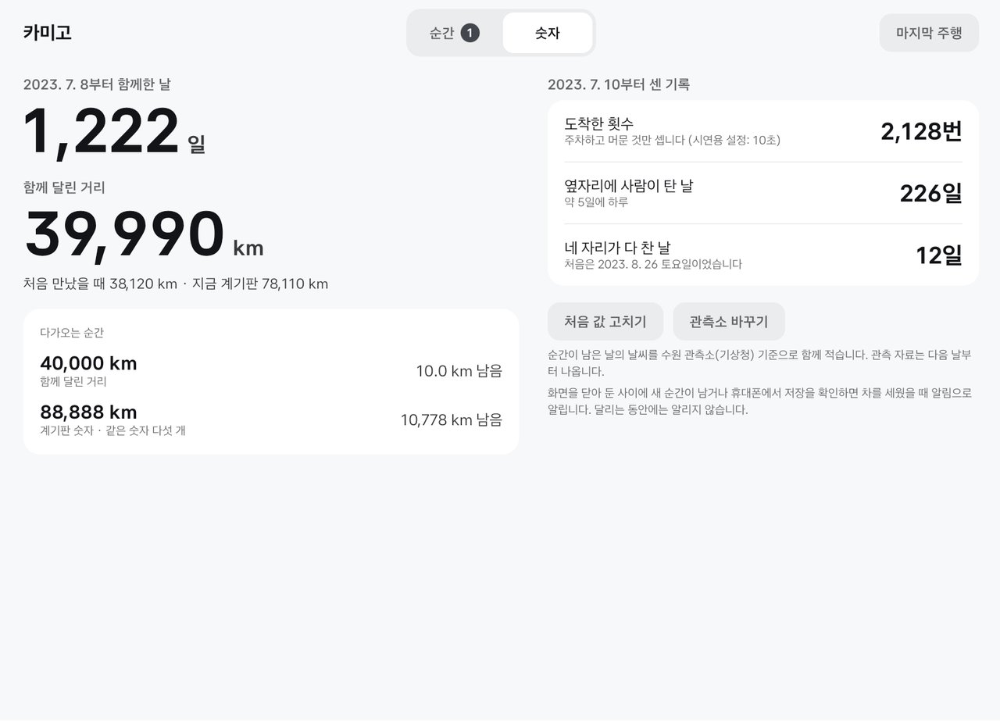
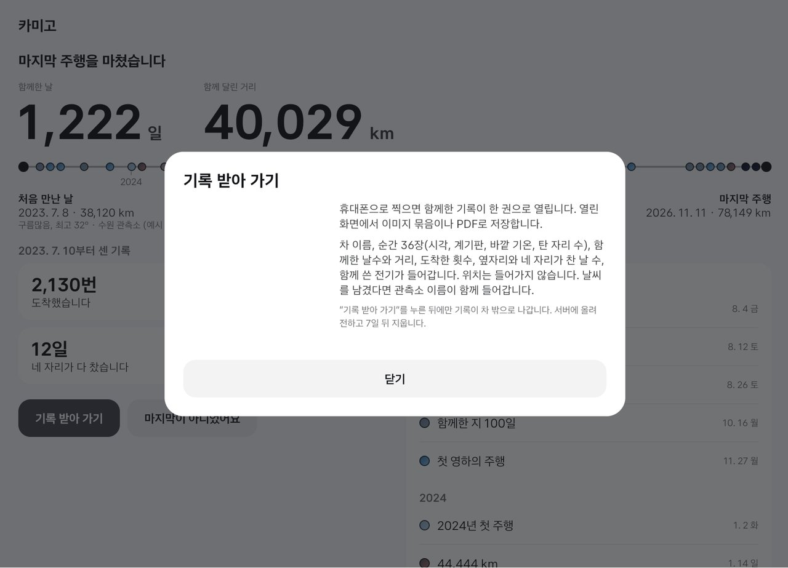
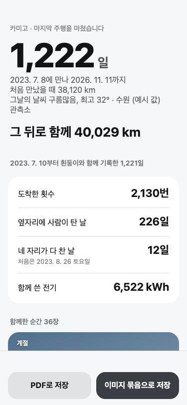
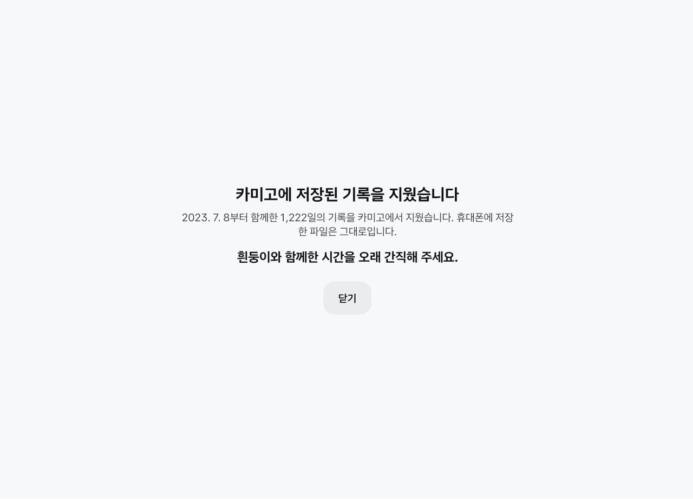

# 카미고 기획서

현대자동차그룹 차량용 앱 개발 공모전 접수양식 "02 앱 프로젝트 소개"의 1~7번 항목에 들어갈 내용입니다. 화면의 숫자는 예시 기록의 값입니다.

앱명 / 프로젝트명: 카미고

## 1. 앱 한 줄 소개

**차와 함께한 순간을 자동으로 모으고, 차를 보내는 날 기록을 휴대폰에 간직하는 앱입니다.**

함께 40,000km를 달린 순간, 네 자리가 처음 다 찬 날, 차를 보내기 전 마지막 주행을 기록으로 남깁니다.

## 2. 기획 배경

**내 차와 내가 처음 만난 날**

차는 매일 출퇴근을 함께하고, 여행의 동반자가 되고, 때로는 혼자 머무는 작은 공간이 됩니다. 함께한 시간은 쌓이지만, 계기판에는 차가 달려온 전체 거리만 남습니다. 그중 얼마를 나와 함께 달렸는지, 어떤 순간을 함께 지났는지는 따로 기록하지 않으면 알기 어렵습니다.

카미고의 출발점은 내 차와 내가 처음 만난 날입니다. 차를 받은 날과 당시 계기판 거리를 기준으로, 나와 함께한 날수와 거리를 보여줍니다. 처음 만났을 때 계기판이 0km였든 이미 수만 km를 달렸든, 그날부터 시작된 우리만의 시간을 기록합니다.

**지나치는 순간을 기록으로**

함께 40,000km를 달린 순간, 네 자리가 처음 다 찬 날, 겨울의 첫 영하 주행처럼 지나칠 때는 알아채기 어려운 순간이 있습니다. 카미고는 차량 신호로 이런 순간을 발견해 카드로 남깁니다. 운전자가 매번 앱을 열거나 직접 적을 필요는 없습니다.

앱은 시각과 거리, 기온, 탄 자리 수처럼 관측한 사실만 적습니다. 부모님과 나들이한 날인지, 친구들과 여행을 떠난 날인지는 사람이 기억합니다. 차는 조용한 증인이고, 기록의 의미는 읽는 사람에게 맡깁니다.

**차를 보내는 날, 함께한 기록은 내가 가져갑니다**

정든 차와 이별하는 일은 거래로만 끝나지 않습니다. 헤이딜러의 "나의 운전 졸업식" 캠페인도 운전을 그만두며 마지막 차와 이별하는 사람들의 모습을 사진으로 남겼습니다(7번 항목의 근거 자료).

카미고는 평소에 모은 기록을 마지막 주행에서 한 사람과 한 차가 함께한 시간으로 묶습니다. 운전자는 기록을 휴대폰에 저장하고, 차에 남은 카미고 기록을 지운 뒤 차를 보냅니다.

- 처음 만난 날: 내 차와 내가 처음 만난 날부터 함께한 날수와 거리를 시작합니다.
- 함께하는 동안: 그 사이의 드문 순간을 자동으로 모읍니다.
- 보내는 날: 마지막 주행으로 기록을 끝맺고, 휴대폰에 받아 간 뒤 차에서 지웁니다.

함께한 순간을 놓치기 쉽고, 차를 보내는 날 그 기록을 따로 받아 가기 어렵다는 문제의식은 작성자의 관찰입니다. 관련 서비스와의 차이는 6번 항목에 정리했습니다.

**차량용 앱으로 만드는 이유**

차 안에서 기어, 누적 주행거리, 좌석 착석 신호를 받아 기록합니다. 계기판 숫자가 넘어가는 순간을 남기고, P에 놓았을 때 카드를 보여주며, 주행 중에는 다가오는 거리 이정표를 음성으로 알립니다. 차량 신호를 기록과 화면 전환에 직접 연결해 운전자의 수동 입력을 줄입니다.

처음 만난 날부터 마지막 주행까지, 카미고가 남기는 것은 차량 관리 점수가 아니라 함께 시간을 보냈다는 흔적입니다.

## 3. 앱 주요 기능 및 차량 특화 요소

**핵심 기능**

처음 만난 날

① 처음 한 번의 입력. 내 차와 내가 처음 만난 날과 당시 계기판 거리, 두 칸만 묻습니다. 지금 계기판은 차에서 읽어 함께한 날수와 거리를 첫 실행부터 보여줍니다. 새 차는 "새 차였어요" 버튼으로 당시 거리를 0km로 넣을 수 있습니다. 원하면 차에 이름을 붙이고(선택, 12자까지), 음성 안내와 마지막 인사에 그 이름을 씁니다. 처음 만난 날과 당시 거리는 받아 가는 기록의 첫 줄이 됩니다. 입력한 정보는 숫자 탭에서 고칠 수 있습니다.

함께하는 동안

② 함께한 순간 (첫 번째 탭 "순간"). 드문 순간을 카드로 남기고, 차를 세운 뒤에 보여줍니다. 카드에는 그때의 시각, 계기판 숫자, 바깥 기온, 탄 자리 수를 적습니다(그림 3). 제목 아래에는 제목에 없는 사실 하나만 더합니다(예: "40,000 km / 함께한 지 1,222일째"). 새 순간은 다음에 앱을 열 때 표시하고, 주차 중 알림을 켠 경우에만 화면 밖에서도 한 줄로 알립니다.

선택 기능인 "그날의 날씨 남기기"를 켜면 기상청 관측 자료와 관측소 이름을 카드에 더합니다. 처음 만난 날에도 사용자가 고른 관측소의 해당 날짜 날씨를 붙일 수 있습니다. 실제 만났던 장소와 관측소가 다를 수 있어 지역 기준을 함께 밝힙니다. 날씨는 기본으로 꺼져 있고, 현재는 인증키 발급 전이라 예시 값으로 흐름만 확인했습니다. 상세 연동 상태는 5번 항목에 적었습니다. 장소 표시는 2단계입니다.

순간의 종류는 다음과 같습니다.

- 함께한 날과 거리: 함께한 지 100일, 500일, 1,000일, 2,000일, 같은 숫자가 나란히 선 날수(1,111일, 2,222일), 해마다 돌아오는 받은 날(1년, 2년, 3년), 함께 달린 거리 10,000km마다, 함께 달린 거리가 지구 한 바퀴(40,075km)가 될 때마다(지구 두 바퀴, 세 바퀴), 아주 오래 함께한 차라면 달까지의 거리(384,400km)가 된 날, 한 번의 주행으로 처음 300km를 넘게 달린 날
- 계절(해마다 한 번씩): 새해 첫 주행, 그해 겨울 처음으로 영하의 바깥 기온에서 달린 날, 그해 처음으로 차가 잰 바깥 기온이 33℃ 이상인 날의 주행. 기온은 차가 잰 바깥 기온입니다.
- 도착: 1,000번째 도착마다(P에 놓고 10분 넘게 머문 것을 도착 한 번으로 셉니다)
- 사람(앱을 설치한 뒤로): 옆자리에 사람이 탄 날이 50번째가 될 때마다, 네 자리가 처음 다 찬 날. 누가 탔는지는 알지 못합니다.
- 가장 멀리, 가장 높이(2단계): 앱을 설치한 뒤로 집에서 가장 멀리 간 곳, 가장 높이 올라간 곳, 하루에 가장 멀리 간 날
- 처음(2단계, 앱을 설치한 뒤로): 그해 가을 첫 히터
- 계기판 숫자와 우연: 77,777km처럼 같은 숫자가 나란히 서는 순간, 45,678km처럼 숫자가 차례로 오르는 순간, 10만 km 단위, 기록된 거리가 100.0km인 주행. "첫날"·"첫 주행"은 앱이 기록을 시작한 뒤의 관측 범위임을 상세 설명에 밝힙니다.

다가오는 이정표는 주행 중에 3km 앞에서 음성으로 한 번 미리 알립니다. 이 차와 함께 달린 거리의 이정표(10,000km마다, 지구 한 바퀴마다, 달까지의 거리)가 먼저이고, 드문 계기판 숫자가 그다음입니다. 예: "약 3킬로미터 뒤에 흰둥이와 함께 달린 거리가 40,000킬로미터가 됩니다." 알림을 켰고 카미고 화면이 닫혀 있을 때는 같은 안내를 화면 위 알림으로도 8초 동안 보여줍니다. 앱 화면을 앞으로 띄우지는 않습니다. 함께 달린 거리는 내 차와 나만의 숫자이기 때문에 이쪽을 앞세웁니다.

③ 함께한 숫자 (두 번째 탭 "숫자"). 함께한 날수와 함께 달린 거리를 가장 크게 보여주고, 지금 계기판 숫자는 그 아래 작은 한 줄로 둡니다(그림 4). 옆에는 세 가지만 놓습니다. 도착한 횟수, 옆자리에 사람이 탄 날, 네 자리가 다 찬 날입니다. 거리 아래 "다가오는 순간"에는 다음 함께 달린 거리 이정표(10,000km마다, 지구 한 바퀴, 달까지의 거리)와 다음 계기판 숫자가 남은 거리와 함께 놓입니다. 집으로 도착한 횟수와 집에서 가장 멀리 간 곳은 2단계에서 더합니다. 브레이크, 방향지시등, 창문 같은 조작 횟수는 넣지 않습니다. 작별의 의미와 거리가 멀고, 횟수를 사실이라고 말하기 어렵기 때문입니다(이유는 5번 항목).

④ 주행 중 화면과 "마지막 주행" 버튼. 달리는 동안에는 구석의 버튼 말고는 함께 달린 거리와 한 줄만 보입니다. "마지막 주행" 버튼은 첫 입력을 마친 뒤 순간 탭, 숫자 탭, 주행 중 화면의 한 구석에 다른 버튼보다 흐린 글자로 늘 있습니다. 당장은 누를 일이 없어도 언젠가 이 차와의 마지막 주행이 온다는 것을 말없이 알려주는 장치입니다. 이 버튼은 앱 화면 안에만 있고, 알림이나 음성으로 마지막을 먼저 꺼내는 일은 없습니다. 주행 중에는 눌리지 않습니다. 다음 주행을 마지막으로 남기기로 정한 뒤에는 "다음 주행을 마지막으로 기록합니다" 상태와 "마지막 주행 취소" 버튼을 분리해 보여 줍니다.

보내는 날

⑤ 마지막 주행과 작별 화면. 차를 보내는 날 "마지막 주행"을 누르면 화면이 한 번 되묻고, 그 주행이 마지막 기록이 됩니다. 달리는 동안에는 "마지막 주행"과 함께한 날수, 함께 달린 거리, 그리고 순간이 점으로 놓인 선만 보이고(그림 7), 도착해 기어를 P(주차)에 놓으면 작별 화면이 나옵니다(그림 8). 맨 위에 함께한 날수와 함께 달린 거리가 가장 크게 놓이고, 그 아래 처음 만난 날(2023. 7. 8 · 38,120 km)부터 마지막 주행(2026. 11. 11 · 78,149 km)까지의 선 위에 순간들이 점으로 놓입니다. 그 아래에 "2023. 7. 10 기록 시작"이라는 작은 제목을 두고 도착한 횟수, 옆자리에 사람이 탄 날, 네 자리가 다 찬 날, 함께 쓴 전기가 이어집니다. 받은 날부터 계산한 값과 앱을 설치한 날부터 센 값은 이렇게 화면에서 나누어 보여줍니다. 옆에는 "함께한 순간 36장" 같은 제목 아래 순간들과 마지막 주행이 놓입니다. 작별 화면과 받아 가는 한 권은 처음 만난 날과 함께한 날수와 거리, 설치한 날부터 센 숫자, 함께한 순간들, 마지막 주행의 순서로 묶습니다(그림 10). 잘못 눌렀다면 "마지막이 아니었어요"로 되돌릴 수 있습니다.

⑥ 기록 받아 가기와 차에서 지우기. QR을 휴대폰으로 찍어 한 권으로 정리된 기록을 열고, 이미지 묶음이나 PDF로 저장합니다. 사용자가 "저장된 것을 확인했어요"를 누르면 차에서 "카미고 기록 지우기"를 사용할 수 있습니다. 지우기 전에 한 번 더 확인하며, 삭제 대상은 카미고의 기록뿐입니다.

차에서 지워도 휴대폰에 저장한 기록은 남습니다. 마지막으로 "흰둥이와 함께한 시간을 오래 간직해 주세요."라는 안내가 나오고, 이를 닫으면 이전 기록이 없는 첫 실행 화면으로 돌아갑니다. 기록은 마지막 주행 전에도 언제든 받아 갈 수 있습니다. 서버 보관 기간과 저장 확인 방식은 5번 항목에 정리했습니다.

**지키는 원칙**

- 차는 증인이지 캐릭터가 아닙니다. 이름을 붙일 수는 있어도 차가 1인칭으로 말하거나 감정을 표현하지 않습니다. 점수, 등급, 배지도 없습니다.
- 앱이 의미를 정하지 않습니다. 카드 제목은 사실만 적고, 불안했을 수도 있는 일(낮은 배터리, 늦은 귀가)을 기록이라며 치켜세우지 않습니다.
- 주인공은 함께한 시간입니다. 가장 큰 숫자는 함께한 날수와 함께 달린 거리이고(작별 화면에서는 날수, 그다음이 거리), 계기판의 누적 주행거리는 작게 씁니다. 77,777km처럼 계기판 숫자가 순간 카드로 남을 때의 카드 제목만 예외입니다.
- 드물게 남깁니다. 목표는 기록이 알림 목록처럼 쌓이지 않는 것입니다. 예시 기록에서는 3년 4개월에 36장이 남았으며, 실제 빈도는 주행과 동승 패턴에 따라 달라집니다. 사용 기록을 보며 기준을 조정합니다.
- 횟수는 어림하지 않습니다. 앱을 설치한 날부터 실제로 센 것만 적고, 언제부터 셌는지 날짜를 함께 적습니다. 설치 전의 횟수와 순간은 다루지 않습니다.
- 주행 중에는 화면이 단순합니다. 앱 안에는 누를 것이 없고, 숫자가 바뀌는 것 말고는 움직임이 없습니다. 다가오는 함께 달린 거리와 계기판 이정표만 음성으로 안내하고, 알림을 켰으며 앱 화면이 닫혀 있을 때는 짧은 화면 위 알림을 함께 보여줍니다. 카드 열람과 설정은 세운 뒤(P)에 열립니다.
- 기록은 차 안에 둡니다. 전체 기록은 "기록 받아 가기"를 누를 때만 서버로 나갑니다. 예외는 사용자가 켠 날씨 조회로, 관측소 번호와 날짜·시각만 보냅니다. 좌표와 탑승자의 신원은 기록하지 않으며, 관측소 이름으로 대략의 지역은 알 수 있습니다. 가입과 로그인은 없습니다.

**차량 특화 요소 (쓰는 신호)**

- 누적 주행거리: 처음에 넣은 값을 빼서 함께 달린 거리를 구합니다. 이번 주행 거리와 계기판 숫자에도 씁니다.
- 기어: 주행 시작과 도착 판단, 주행 중 화면 전환
- 좌석별 착석: 탄 자리 수, 옆자리에 사람이 탄 날, 네 자리가 다 찬 날
- 위치와 고도, 내비 즐겨찾기의 집(2단계. 주소 제공 여부는 5번 항목): 집으로 도착한 횟수, 집에서 가장 멀리 간 곳, 카드의 장소
- 바깥 기온과 공조: 카드에 남기는 기온, 첫 히터(2단계)
- 배터리의 남은 에너지: 함께 쓴 전기(작별 화면의 한 줄)
- 음성 안내(TTS)와 화면 위 알림: 다가오는 함께 달린 거리와 계기판 이정표를 한 번 안내. 알림을 켰고 앱 화면이 닫혀 있으면 8초 동안 한 줄로도 표시
- 차 밖의 자료(기상청 지상 관측): 순간과 받은 날의 날씨. 차가 직접 알 수 없는 것 하나를 공공 관측 자료로 채웁니다.

**화면**

모두 실제로 실행한 화면입니다. 그림 10은 휴대폰으로 연 웹 페이지이고 나머지는 Pleos Connect 에뮬레이터의 앱 화면입니다. 화면의 기록은 예시입니다. 손으로 적은 값이 아니라, 중고로 차를 받은 이틀 뒤 앱을 설치해 3년 넘게 탄 경우의 주행을 앱의 판정 규칙에 넣어 만든 기록이며, 4번 항목의 장면도 같은 기록을 따릅니다. 화면 위쪽의 시스템 상태 줄은 잘라냈고, 그림 9의 QR은 실제 주소여서 가렸습니다.

그림 1. 첫 실행. 차를 받은 날과 차를 받았을 때 계기판 거리, 두 칸만 입력합니다. 지금 계기판은 차에서 읽고, 넣는 즉시 함께한 날수와 거리가 나옵니다.

그림 2. 순간 탭. 맨 위에 함께한 날수와 함께 달린 거리, 함께한 순간의 수가 있고, 순간이 최근 것부터 놓입니다. 3년 4개월 동안 남은 36장 가운데 12장이 보입니다. 맨 위는 방금 남은 "40,000 km / 함께한 지 1,222일째"입니다. 오른쪽 위에 "마지막 주행" 버튼이 늘 있습니다.

그림 3. 순간 카드 "40,000 km"(종류: 함께 달린 거리). 이 차와 함께 달린 거리가 40,000km를 넘은 순간의 시각, 계기판, 바깥 기온, 탄 자리가 남습니다. 누가 탔는지는 적지 않습니다. 그날의 날씨와 관측소는 관측 자료가 올라오는 다음 날쯤 이 카드에 한 줄로 더해집니다.

그림 4. 숫자 탭. 함께한 날수와 함께 달린 거리가 가장 크고, 처음 만났을 때와 지금의 계기판은 그 아래 한 줄입니다. 그 아래 "다가오는 순간"에 다음 함께 달린 거리 이정표와 다음 계기판 숫자가 남은 거리와 함께 놓입니다. 오른쪽은 앱을 설치한 날부터 센 숫자입니다.

그림 5. 주행 중 화면. 함께 달린 거리와 한 줄("40,000 km까지 3.0 km")만 보입니다. 이때 같은 내용의 음성 안내가 한 번 나옵니다.

그림 6. 마지막 주행을 누르면 한 번 되묻습니다.

그림 7. 마지막 주행 중 화면. 함께한 날수와 함께 달린 거리, 처음 만난 날부터 오늘까지 순간이 점으로 놓인 선만 보입니다.

그림 8. 작별 화면. 함께한 날수와 함께 달린 거리를 가장 크게 두고, 그 아래 처음 만난 날부터 마지막 주행까지의 선 위에 순간들이 점으로 놓입니다. 왼쪽은 설치한 날부터 센 숫자, 오른쪽은 해마다 함께한 순간들입니다.

그림 9. 기록 받아 가기. QR로 휴대폰에서 엽니다.

그림 10. 휴대폰으로 받은 기록의 첫 화면(실제 서버에서 연 웹 페이지). 처음 만난 날과 그날의 날씨, 함께한 날수와 거리, 함께 기록한 숫자가 먼저 나오고, 아래로 순간들과 마지막 주행이 이어집니다. 아래의 두 버튼으로 PDF나 이미지 묶음으로 저장합니다. 카드 위의 띠는 그 시각의 하늘빛이고, 날씨 줄에는 관측소 이름이 함께 적힙니다.

그림 11. 휴대폰에서 "저장된 것을 확인했어요"를 누르면 차의 화면에 안내가 뜨고, 그때부터 카미고 기록을 지울 수 있습니다.

그림 12. 지우기 전에 한 번 더 묻습니다.

그림 13. 차에 남은 기록을 지운 뒤의 마지막 안내. 차 이름과 함께 "함께한 시간을 오래 간직해 주세요"라는 안내를 남깁니다. 이 화면을 닫으면 첫 실행 화면으로 돌아가고 날짜와 날수도 남지 않습니다.

## 4. 주요 사용 시나리오

**장면 1. 차를 받은 이틀 뒤 (주차 중)**

아래는 처음 만났을 때 계기판이 38,120km였던 차 "흰둥이"의 예시입니다. 운전자는 차를 받은 이틀 뒤 앱을 처음 엽니다. 처음 만난 날과 당시 계기판 거리를 넣자 "함께한 지 2일. 함께 달린 거리 30km."가 나옵니다(그림 1). 처음 만났을 때의 계기판이 0km인 경우에도 같은 방식으로 시작합니다. 화면 구석에는 "마지막 주행"이라는 버튼이 있지만, 당장 누를 일은 없습니다. 그 뒤로는 함께하는 동안의 순간이 자동으로 쌓입니다.

**장면 2. 한 달 반 뒤 토요일 점심**

부모님을 모시고 넷이 나들이를 갑니다. 도착해 기어를 P에 놓자 카드가 하나 남아 있습니다. "네 자리가 다 찬 날. 기록을 시작한 뒤로 네 자리가 모두 찬 첫 주행입니다. 누가 탔는지 차는 모릅니다." 그날이 어떤 날이었는지는 운전자만 압니다.

**장면 3. 함께한 지 3년 4개월이 된 어느 날**

달리는 중에 "약 3킬로미터 뒤에 흰둥이와 함께 달린 거리가 40,000킬로미터가 됩니다"라는 음성 안내가 한 번 나옵니다. 화면에는 함께 달린 거리와 한 줄만 있습니다(구성은 그림 5와 같습니다). 운전자는 휴대폰을 들 필요가 없습니다. 차를 세우면 그 순간의 시각과 기온이 적힌 카드가 남아 있습니다. 순간 탭에는 이런 카드가 3년 4개월 동안 서른여섯 장 쌓입니다(그림 2).

**장면 4. 차를 보내는 날 (받은 지 1,222일)**

차를 가지러 오기로 한 날입니다. 운전자는 3년 넘게 화면 구석에서 보기만 했던 "마지막 주행"을 처음으로 누릅니다. 화면이 "이 차와의 마지막 주행인가요"라고 되묻습니다(그림 6). 마지막으로 동네를 한 바퀴 돌고 집으로 돌아오는 동안 화면에는 "마지막 주행 · 함께한 지 1,222일째"와 처음 만난 날부터 오늘까지의 선만 보입니다(그림 7). 집에 도착해 기어를 P에 놓자 작별 화면이 열립니다(그림 8). 1,222일, 처음 만났을 때 38,120km, 그 뒤로 함께 40,029km, 그리고 처음 33℃ 이상에서 달린 날의 주행부터 시작하는 서른여섯 장의 순간입니다.

운전자는 "기록 받아 가기"를 눌러 QR을 휴대폰으로 찍고(그림 9), 열린 화면에서 한 권을 휴대폰에 저장하고(그림 10) "저장된 것을 확인했어요"를 누릅니다. 차의 화면에 지우기 버튼이 열립니다(그림 11). "카미고 기록 지우기"를 누르면 한 번 더 묻고(그림 12), 지우고 나면 "카미고에 저장된 기록을 지웠습니다"와 "흰둥이와 함께한 시간을 오래 간직해 주세요."가 남습니다(그림 13). 운전자는 운전대를 한 번 쓰다듬고 열쇠를 건넵니다.

**누가 쓰는가**

차를 오래 타는 사람, 차에 정이 드는 사람, 가족과 함께 타는 일이 많은 사람입니다. 매일 여는 앱이 아닙니다. 한 번 설치해 두면 가끔 순간이 하나씩 남고, 마지막 날에 한 번 크게 쓰입니다.

## 5. 개발 계획

**현재 상태**

- 앱 구현: Kotlin과 Jetpack Compose로 1단계 범위를 구현했습니다. Pleos Connect 에뮬레이터에서 첫 입력부터 주행, 순간 카드, 마지막 주행, 기록 받아 가기, 휴대폰에서 확인, 차에서 지우기, 다시 열면 첫 입력 화면이 나오는 것까지 한 번에 실행해 확인했습니다. 3번 항목의 그림은 그 뒤 예시 기록을 넣고 같은 흐름을 다시 실행해 찍은 것입니다. 지운 뒤 저장 파일에 날짜나 요약이 남지 않는 것, 재부팅한 뒤 앱을 열지 않고 달려도 기록이 이어지는 것도 확인했습니다. 판정 규칙은 단위 테스트 52개로 검증합니다.
- 신호 확인: 이 앱이 쓰는 차량 신호를 신호 확인용 시험 앱으로 Pleos Connect 에뮬레이터(API 34, 전기차 이미지)에서 하나씩 읽어 보았고, 확인된 것과 안 된 것을 아래에 신호별로 표시했습니다.
- 기록 받아 가기 서버와 휴대폰 페이지: 배포해 실제로 동작합니다(그림 10).

구현과 확인의 범위는 다음과 같습니다. 기능 구현과 실차 검증은 구분합니다.

| 구분 | 현재 상태 |
|---|---|
| 핵심 경험 | 첫 입력, 자동 기록, 순간 카드, 마지막 주행, 휴대폰 저장 확인과 차에서 지우기까지 구현하고 에뮬레이터에서 흐름 확인 |
| 차량 신호 | 기어·주행거리·착석·배터리 값은 에뮬레이터에서 확인. 실차 동작과 상주 서비스 허용 여부는 미확인 |
| 날씨 | 조회 흐름은 구현하고 예시 값으로 확인. 인증키 발급 뒤 실제 관측 자료 연결 검증 필요 |
| Pleos 위치 조회 | 시험 앱에서 값 확인. 본 앱의 FusedLocation 동작은 확인 예정 |
| 확장 기능 | 장소, 집 도착 횟수, 가장 멀리·높이 간 곳, 첫 히터는 2단계 계획 |

**구조**

- 화면 없이 기록하는 부분: 부팅 완료 알림을 받아 포그라운드 서비스(화면 없이 계속 도는 안드로이드 서비스)를 띄우고 Vehicle SDK의 변경 알림을 구독합니다. 에뮬레이터를 재부팅한 뒤 앱을 열지 않아도 이 서비스가 다시 뜨는 것을 본 앱에서 확인했고, 화면 없이 신호를 받는 것은 시험 앱으로 확인했습니다(설치 뒤 한 번은 앱을 열어야 합니다). "설치한 뒤 아무것도 하지 않아도 차가 기억한다"는 약속이 여기에 달려 있으므로, 실차에서 시동을 다시 걸 때도 같은 방식으로 시작되는지와 상주 서비스의 앱마켓 심사 기준을 가장 먼저 확인합니다. 함께한 날수와 거리, 마지막 주행과 받아 가기는 입력한 값과 지금 계기판만으로 계산되므로 상주 동작이 제한되어도 그대로 동작합니다.
- 저장: 시동을 끄면 앱이 중단될 수 있다고 보고 값이 바뀔 때마다 앱 전용 폴더의 파일에 바로 씁니다. 쓰는 도중에 꺼져도 깨지지 않도록 임시 파일에 쓴 뒤 통째로 바꿉니다.
- 도착의 기준: 기어를 P에 놓은 것만으로는 도착으로 세지 않습니다. 1단계에서는 P에 놓은 뒤 10분 넘게 머문 것을 도착 한 번으로 셉니다. 신호 대기나 잠깐 세운 것을 빼기 위해서이며, 기준 시간은 실제 주행 기록으로 조정합니다. 시동 꺼짐을 앱이 알 수 있는지는 에뮬레이터로 확인하지 못했고, 실차에서 확인되면 시동이 꺼진 것도 도착으로 셉니다. 주행이 끝났다는 판정(카드 남기기, 작별 화면 열기)은 P에 놓는 즉시 하고, 마지막 주행은 P에 놓는 즉시 도착으로 셉니다.
- 순간 판정: 숫자 카드는 넘어가는 순간에 기록하고, 나머지는 주행이 끝나 P에 놓일 때 이번 주행을 지금까지의 기록과 비교해 판정합니다. 판정 규칙은 차량 SDK와 분리한 순수 Kotlin으로 작성해 단위 테스트로 검증합니다.
- 화면: Compose. Pleos Connect UI 디자인 가이드의 색, 글자 위계, 버튼과 탭과 팝업 구조를 따르고 라이트와 다크, 가로와 세로 화면을 지원합니다. 그래서 차 화면의 순간 카드는 평평한 카드에 그 시각의 하늘빛을 작은 점으로만 두고(그림 2), 하늘빛 띠는 휴대폰으로 받는 한 권에 씁니다(그림 10). 플랫폼의 주행 중 제한(P가 아닐 때 영상과 설정 화면 제한)을 따르고, 그보다 좁게 D와 R에서는 주행 중 화면만 보이도록 앱에서 설계합니다. 입력, 카드 열람, 마지막 주행 버튼은 P에서만 동작합니다.
- 기록 받아 가기: 운전자가 버튼을 누르면 정리한 기록을 서버에 올리고, 그 주소를 QR로 띄웁니다. 휴대폰은 앱 설치 없이 웹 페이지로 받습니다. 주소는 추측할 수 없는 긴 임의 값으로 만들고, 올린 기록은 7일 뒤 지웁니다. 차에서 기록을 지워도 서버의 한 권은 그 7일 동안 남겨 둡니다. 휴대폰 저장이 실제로는 실패했을 때 하나뿐인 사본이 사라지지 않게 하기 위해서입니다. 받는 화면은 이미지 묶음과 PDF로 저장하는 버튼과 "저장된 것을 확인했어요" 버튼을 두고, 확인을 누르면 서버에 표시를 남깁니다. 차의 앱은 그 표시를 확인한 뒤에만 "카미고 기록 지우기"를 열고, 지우기 전에 한 번 더 묻습니다. 앱에서 외부 서버로 HTTPS 요청이 되는 것은 에뮬레이터에서 확인했습니다.

**SDK와 API 사용 계획** ([확인]은 에뮬레이터에서 값을 읽고, 버추얼 콘솔(에뮬레이터의 차량 값을 바꾸는 도구)에서 바꾼 값이 앱에 반영되는 것을 본 신호)

- Vehicle SDK 누적 주행거리 [확인]: 처음에 넣은 값을 빼서 함께 달린 거리를 구하고, 다가오는 계기판 숫자에도 씁니다. 이번 주행 거리는 출발과 도착 때의 값 차이로 계산합니다. 에뮬레이터에서 소수 자리까지 그대로 오는 것을 확인했습니다. 실차가 1km 단위로만 준다면 남은 거리는 1km 단위로 보여주고, "100.0km" 같은 소수 자리 카드는 만들지 않습니다.
- Vehicle SDK 기어 [확인]: 주행 시작(D)과 도착(P).
- 쓰지 않기로 한 신호: 브레이크 페달, 방향지시등, 창문 위치는 값은 읽히지만 에뮬레이터에서 일부 알림이 빠지는 것을 확인했습니다. 받은 알림을 더한 값을 실제 조작 횟수라고 말할 수 없어 횟수 기록에서 뺐습니다.
- Vehicle SDK 좌석 착석 [확인]: 탄 자리 수. 에뮬레이터에서 값이 반대로 들어오는 것을 확인했으며, 실차에서 다시 확인해 맞춥니다.
- Vehicle SDK 배터리 남은 에너지(Wh) [확인], 용량 [조회 확인]: 함께 쓴 전기. 남은 에너지가 바뀔 때마다 알림이 오는 것을 확인했고, 줄어든 만큼을 더합니다. 앱이 꺼진 사이 줄어든 양은 세지 않습니다.
- 충전 횟수와 기름차의 연료 누적은 초기 범위에 넣지 않습니다. 충전 한 번의 판정은 에뮬레이터로 확인할 수 없었고, 연료 잔량과 연비는 SDK 라이브러리에 함수가 정의된 것만 확인했으며 제공되는 에뮬레이터가 전기차 이미지뿐이라 시연은 전기차로 합니다. 함께 쓴 전기 한 줄 말고는 내연기관차에서도 똑같이 동작합니다.
- Vehicle SDK 공조 [설정 온도와 풍량은 확인, 전원 변경 알림은 에뮬레이터에서 받지 못함], 안드로이드 차량 속성의 바깥 기온 [읽기만 확인]: 첫 히터와 카드의 기온. 첫 히터는 설정 온도와 바깥 기온으로 판단하며 실차 확인이 필요합니다.
- Pleos FusedLocation [위치 값은 시험 앱으로 확인, 이 앱에 넣은 것은 에뮬레이터 확인 예정]: 1단계에서는 날씨를 켤 때 "지금 위치에서 가장 가까운 곳"으로 관측소를 고르는 데 씁니다(몇 초 안에 답이 없으면 안드로이드 위치 서비스로 넘어갑니다). 순간마다의 관측소는 차가 마지막으로 안 위치로 고릅니다. 2단계에서는 위치와 고도[고도 값은 실차 확인 필요]로 집에서 가장 멀리 간 곳, 가장 높이 올라간 곳을 찾습니다. 카드의 장소는 좌표를 주소로 바꿔 적으며, Pleos 내비 연동 API(NaviHelper)가 현재 위치의 주소를 주는지는 API 제공 여부부터 확인이 필요합니다. 기기 안에서 주소로 바꾸지 못하면 장소 칸은 비워 둡니다. 위치를 서버로 보내 변환하지는 않습니다.
- NaviHelper 즐겨찾기의 집 [조회 확인]: 즐겨찾기에 집 좌표가 제공되면 현재 위치와 비교해 집으로 도착한 횟수를 셉니다. 내비에 집이 등록된 경우에만 보여주며, 도착 판정은 실차 확인이 필요합니다.
- Pleos TTS [에뮬레이터에서 TTS 엔진이 앱의 문장을 받아 재생 시작과 종료를 알린 것을 로그로 확인]: 다가오는 숫자 음성 안내.
- 알림: 에뮬레이터에서 일반 알림은 알림 센터에만 들어가고, 메시지 종류로 지정한 알림만 화면 위에 뜨는 것을 확인했습니다. 새 순간과 휴대폰 저장 확인은 주차 중에만 알립니다. 별도로, 카미고 화면이 닫혀 있을 때 이정표 3km 전의 음성 안내를 화면 위 알림으로도 보여주고 8초 뒤 자동으로 사라지게 했습니다. 권한은 첫 실행에 묻지 않고 숫자 탭의 알림 설정에서 사용자가 켤 때 묻습니다. 마지막 주행을 먼저 꺼내는 알림은 없습니다.
- 기상청 지상(종관) 관측 자료(공공데이터포털 공개 API, 무료) [구현. 흐름은 에뮬레이터에서 예시 값으로 확인했고, 실제 관측 자료 연결은 인증키 발급 뒤 확인]: 시간자료의 구름 양, 강수량, 적설로 순간의 날씨를, 일자료로 날짜만 아는 카드와 받은 날의 날씨를 가져옵니다. 하늘은 기상청 기준대로 구름 양 0~5는 맑음, 6~8은 구름많음, 9~10은 흐림으로 적고, 비나 눈이 관측되면 그것을 먼저 적습니다. 관측소 95곳의 목록을 앱에 넣어 두고 차 안에서 가장 가까운 곳을 고르며(사용자가 이름으로 직접 고를 수도 있습니다), 서버로는 관측소 번호와 날짜, 시각만 나갑니다. 인증키는 앱에 넣지 않고 서버에 둡니다. 통신이 안 되거나 자료가 없으면 날씨 줄을 비워 두고 예보나 어림값으로 채우지 않습니다. 받아 가기를 누른 뒤에는 올린 한 권이 달라지지 않도록 더 채우지 않습니다. 공개 문서상 Pleos Connect 앱은 외부 서버와 HTTPS로 통신할 수 있고, 에뮬레이터에서 확인했습니다.
- 차량을 제어하는 API는 쓰지 않습니다. 읽기와 알림만 쓰며, 필요한 읽기 권한은 매니페스트에 선언하고 주행 중 화면은 주행 중 사용 가능 화면으로 선언합니다.

**개발 순서**

- 1단계(구현한 범위): 첫 실행 입력, 함께한 날수와 함께 달린 거리, 순간 탭과 카드(함께한 날과 거리, 사람, 계절, 도착, 같은 숫자가 나란히 서거나 차례로 오르는 계기판 숫자와 100.0km. 카드에는 시각, 계기판, 바깥 기온, 탄 자리), 다가오는 함께 달린 거리와 계기판 이정표의 음성 안내, 주행 중 화면, 숫자 탭(도착한 횟수, 옆자리에 사람이 탄 날, 네 자리가 다 찬 날), 마지막 주행과 작별 화면(함께 쓴 전기 한 줄 포함), 기록 받아 가기와 저장 확인 뒤 지우기. 선택 기능인 날씨 조회는 예시 값으로 흐름을 확인했으며 실자료 연결과 본 앱의 Pleos 위치 조회 검증은 남아 있습니다.
- 실차 확인(본선에서 실차나 실차 수준의 환경이 주어질 때 확인할 것. 순서대로): ① "구조" 첫머리에 적은 전제(시동을 다시 걸 때의 자동 시작과 심사 허용 여부). ② 착석 값의 방향 ③ 실차의 주행거리 값 단위 ④ 도착 기준(시동 꺼짐을 앱이 알 수 있는지) ⑤ 고도, 현재 위치의 주소, 집 도착 판정 ⑥ 시동을 껐다 켠 사이의 에너지 변화 ⑦ 공조 전원 알림 ⑧ 음성 안내가 실제로 들리는 크기와 시점.
- 2단계(실차 확인 결과에 따라 넣는 범위): 카드의 장소, 집으로 도착한 횟수, 집에서 가장 멀리 간 곳과 가장 높이 올라간 곳, 하루에 가장 멀리 간 날, 첫 히터. 판정 기준값은 실제 주행 기록으로 조정합니다.
- 시연: 에뮬레이터의 버추얼 콘솔로 주행거리, 기어, 착석, 배터리의 남은 에너지 값을 바꿔 가며 함께 달린 거리가 40,000km를 넘는 장면과 마지막 주행을 재현합니다.
- 심사용 시연 모드: 버추얼 콘솔 없이도 앱만으로 같은 흐름을 볼 수 있습니다. 첫 화면의 로고나 앱 이름을 길게 누르면 시연 창이 열리고, 예시 기록(흰둥이, 3년 4개월, 함께 39,996km)을 오늘 날짜에 맞춰 불러온 뒤 "시연 주행"으로 함께 40,000km의 음성 안내와 새 카드, 마지막 주행, 작별 화면, 기록 받아 가기와 지우기까지 이어 봅니다. 시연 모드에서는 실제 차 신호를 받지 않으며, 끄면 기록을 지우고 첫 화면으로 돌아갑니다. 순서는 저장소 README의 "5분 시연"에 있습니다. [확인: 에뮬레이터에서 README의 1~8단계를 새로 설치한 앱으로 모두 거침]

**알고 있는 한계와 대응**

- 시동 전에 일어난 일은 볼 수 없습니다. 그래서 문 여닫은 횟수처럼 빠짐이 큰 숫자는 넣지 않았습니다.
- 하늘이 맑았는지 흐렸는지는 차의 신호로 알 수 없습니다. 그래서 기상청 관측 자료를 씁니다. 관측소가 있는 곳의 날씨이므로 카드에 관측소 이름을 함께 적습니다. 받은 날의 날씨는 날씨를 켤 때 고른 관측소 기준이고, 순간의 날씨는 그때 가장 가까운 관측소 기준입니다.
- 앱이 꺼져 있는 사이에 지나간 계기판 숫자는 카드로 남기지 않습니다. 함께한 날 카드도 설치한 뒤에 맞은 날만 남깁니다.
- 차종마다 지원하는 신호가 다릅니다. 지금은 순간 카드에서 읽지 못한 값(바깥 기온, 탄 자리 수)의 줄을 빼고, 함께 쓴 전기는 1kWh 미만이면 빼는 데까지 구현했습니다. 착석 신호가 없는 차에서 숫자 탭의 사람 관련 칸을 숨기는 것은 아직 넣지 않았으며 그렇게 하도록 설계합니다.
- 계기판 숫자가 늘지 않은 채 기어만 D와 P를 오간 것은 주행이나 도착으로 세지 않습니다. 마지막 주행을 마친 뒤 다시 달리면 마지막 주행이 이어지는 것으로 봅니다.
- 처음에 넣은 받은 날과 주행거리는 숫자 탭에서 고칠 수 있습니다.
- 마지막 주행은 되돌릴 수 있고, 카미고 기록 지우기는 따로 한 번 더 확인합니다.

## 6. 기대효과 및 발전 가능성

**사용자에게 주는 가치**

- 차를 보내는 날, 빈손이 아니라 한 권의 기록을 들고 내립니다.
- 차와 함께한 시간이 기록으로 남습니다. 계기판의 숫자만으로는 알 수 없는 "나와 함께 달린 거리"를 알게 됩니다. 처음 한 번의 입력 뒤로 운전자는 아무것도 하지 않아도 됩니다.
- 놓치던 순간이 남습니다. 운전 중에 휴대폰을 들지 않아도 됩니다.
- 평가받지 않습니다. 운전 점수나 연비 관리와 달리 잘하고 못하고가 없습니다.

**플랫폼에 주는 가치**

- 내 차와 내가 처음 만난 날을 관계의 출발점으로 삼습니다. 출고 후 처음 함께하는 차도, 이미 달려온 차도 그 사람과의 시간을 쌓으며 자기 차에 대한 애착을 만들 수 있습니다.
- 차에 대한 애착은 브랜드에 대한 애착으로 이어질 수 있다고 봅니다. 차의 신호가 관리와 안전 말고도 감성적인 경험에 쓰일 수 있다는 사례가 됩니다.
- 마지막 주행은 다음 차의 첫 주행과 맞닿아 있습니다. 받아 간 기록을 같은 플랫폼의 다음 차에서 "이전 차와의 날들"로 이어 보여줄 수 있어, 다음 차도 같은 플랫폼을 고를 이유가 됩니다.

**타깃 고객**

- 1차: 내 차와 함께한 시간을 남기고 싶은 자가 운전자입니다. 차를 처음 만난 사람은 첫날부터 기록을 시작하고, 이미 오래 함께한 사람도 처음 만난 날과 당시 계기판을 입력해 함께한 날수와 거리를 돌아볼 수 있습니다. 세부 순간과 횟수는 설치한 뒤부터 쌓입니다. 구매 방식보다 차에 대한 애착과 기록을 남기고 싶은 마음을 기준으로 합니다.
- 2차(제휴): 차량 인도와 인계 과정에 연결합니다. 차를 받는 날에는 기록을 시작하도록 안내하고, 인증중고차·트레이드인 등 차를 보내는 과정에서는 이미 쌓인 기록을 받아 가도록 돕습니다. 보내는 날 처음 설치한 경우에는 과거의 세부 순간을 복원할 수 없습니다.

**예상 MAU (가정)**

Pleos Connect 지원 차량 수와 앱마켓 설치율에 대한 공개 수치를 찾지 못해 식과 가정으로 제시합니다. 월 활성 차량 = 지원 차량 수 × 설치율 × 그 달에 한 번 이상 화면을 연 비율. 지원 차량 100만 대당 낮게 잡으면 설치율 3%, 열람률 40%로 약 1만 2천 대, 높게 잡으면 설치율 10%, 열람률 60%로 약 6만 대입니다. 세 값 모두 가정입니다. 기록은 날씨 조회와 기록 받아 가기 말고는 서버로 보내지 않으므로 출시 뒤에는 앱마켓이 제공하는 통계 범위에서 확인합니다.

**Retention을 보는 방법**

설치해 두면 열지 않아도 기록되는 앱입니다. 화면을 열지 않아도 기록은 계속되고, 새 순간은 드물게만 남습니다(예시 기록에서는 3년 4개월에 36장). 그래서 일간 접속률보다 설치 뒤 90일이 지나도 지우지 않은 비율과, 한 달에 한 번 이상 화면을 연 비율을 지표로 삼습니다. 쌓일수록 지우기 아깝고 마지막 주행이라는 끝이 정해져 있어 오래 남겨 둘 이유가 있는 구조이지만, 실제 값은 출시 뒤 앱마켓 통계가 제공하는 범위에서만 알 수 있습니다.

**향후 확대 계획**

- 받아 간 기록을 다음 차에서 이어 보기. 이 경우에만 계정이 필요합니다.
- 한 차를 여럿이 타는 가족을 위한 운전자별 기록.
- 차의 음성 비서(Gleo)에 "흰둥이와 함께한 지 얼마나 됐어?" 같은 질문을 등록해, 화면을 보지 않고도 함께한 날수와 거리를 답하게 합니다. 앱 기능 등록(App Schema)은 승인 절차가 열리면 진행합니다.
- 개인 사용자에게는 무료로 제공합니다. 수익은 두 갈래입니다. 하나는 받아 간 기록을 책이나 인화물로 만드는 유료 출력 서비스이고, 다른 하나는 위의 제휴처(인증중고차, 트레이드인, 신차 인도)가 고객 경험으로 이 기능을 쓰는 제휴입니다. 어느 쪽이 먼저인지는 사용 기록을 본 뒤 정합니다.
- 성장의 축은 "다음 차에서 이어 보기"입니다. 같은 플랫폼의 다음 차에서 이전 차와의 기록을 이어 볼 수 있으면, 그것이 다음 차도 같은 플랫폼을 고를 이유가 됩니다.

**비슷한 출품작과의 차이** (공개된 출품작 소개글의 앞부분을 2026년 11월 10일에 확인한 범위)

- 차를 보내는 날의 마지막 주행과 작별을 기록으로 남기는 출품작은 확인한 범위에서 찾지 못했습니다. 차를 팔 때의 가치와 증빙을 다루는 앱(관리 이력, 구매자용 보고서, 가치를 다음 주인에게 잇는 차량 이력)은 있습니다. 그 앱들은 다음 주인에게 넘길 정보를 다루고, 이 앱은 이전 주인이 가져갈 개인적인 기억을 다룹니다.
- 차계부와 주행 일지 앱은 차의 상태와 운행 하나하나의 목록이 중심입니다. 이 앱은 한 차와 함께한 소유 기간 전체와 드문 순간이 중심입니다.
- 점수와 배지와 레벨을 주는 앱은 달성을 평가하고 보상합니다. 이 앱은 함께 지나온 흔적으로만 남깁니다.
- 캐릭터와 일기 앱 가운데 일부는 차가 1인칭으로 감정을 말합니다. 이 앱의 차는 말하지 않습니다.
- 차가 알아서 기록하고 카드로 남기며 QR로 휴대폰에 넘기는 형식은 다른 출품작에도 있습니다. 이 앱의 차이는 그 기록을 한 사람과 한 차의 처음 만난 날부터 작별까지로 묶고, 받아 가고 지우는 끝을 설계했다는 점입니다.

## 7. 참고자료

- 화면: 3번 항목의 그림 13장(실제 앱 화면 12장, 휴대폰으로 연 화면 1장)
- 근거 자료: 운전을 그만두는 사람들의 마지막 차와의 이별을 사진으로 남겨 주는 헤이딜러 "나의 운전 졸업식" 캠페인 소개 글(보그 코리아의 광고 콘텐츠, 2025) https://www.vogue.co.kr/?p=643012
- 기술 근거: Pleos Playground 개발 문서
- 소스 코드와 APK: https://github.com/raphael1063/carmigo (실행 방법과 테스트 환경은 README, APK는 apk/ 폴더)

